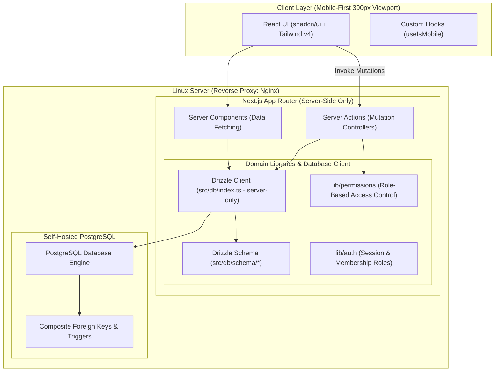

# System Architecture: Multi-Tenant Barber Appointment Platform

## 1. High-Level Architecture Overview

The application is built on Next.js App Router, fully self-hosted on Linux behind Nginx, backed by standard PostgreSQL and Drizzle ORM.



---

## 2. Directory Architecture & Separation of Concerns

The codebase is organized into strict modular boundaries:

```
src/
├── actions/                  # Next.js Server Actions (Mutation controllers)
├── app/                      # Next.js App Router route groups & layouts
│   ├── (auth)/               # Authentication route group (Login)
│   │   ├── layout.tsx
│   │   └── login/page.tsx
│   ├── (dashboard)/          # Authenticated portal (Owner, Admin & Staff)
│   │   ├── layout.tsx
│   │   └── dashboard/page.tsx
│   ├── (public)/             # Public customer-facing booking funnel
│   │   ├── layout.tsx
│   │   └── page.tsx          # Mobile-first landing & booking entry
│   ├── globals.css           # Tailwind v4 theme & base variables
│   └── layout.tsx            # Global HTML document shell
├── components/               # UI Presentation components
│   ├── common/               # Shared presentational widgets (StatusBadge)
│   ├── layout/               # Shell components (Header, MobileNav)
│   └── ui/                   # Reusable shadcn/ui primitives (Button, Card, Input)
├── db/                       # Database layer (Server-only)
│   ├── index.ts              # Server-only Drizzle client setup (`drizzle-orm/node-postgres`)
│   └── schema/               # Drizzle table schemas, composite FKs & enums
│       ├── users.ts          # Core system user records
│       ├── businesses.ts     # Business tenant boundaries
│       ├── members.ts        # Business members and roles (`OWNER`, `ADMIN`, `STAFF`)
│       ├── services.ts       # Dynamic service catalogs
│       ├── staff.ts          # Staff profiles & staff-service mappings
│       ├── customers.ts      # Business-scoped customer records
│       ├── scheduling.ts     # Business/staff working hours & time blocks
│       ├── appointments.ts   # Appointments & service snapshots
│       └── index.ts          # Schema barrel export
├── hooks/                    # Client-side custom React hooks
│   └── use-mobile.ts         # Viewport subscription (useSyncExternalStore)
├── lib/                      # Core business logic
│   ├── auth/                 # Session & role helpers
│   ├── permissions/          # Role-Based Access Control (RBAC) matrices
│   └── utils.ts              # CSS utility (twMerge + clsx)
├── middleware.ts             # Next.js root request interceptor
└── types/                    # Domain models & TypeScript interfaces
    ├── business.ts           # Business & working hours types
    ├── staff.ts              # Staff profile, services, and time block types
    ├── service.ts            # Dynamic service model types
    ├── customer.ts           # Business-scoped customer types
    ├── appointment.ts        # Appointment & snapshot types
    ├── user.ts               # Auth user & membership types
    └── index.ts              # Types barrel export
drizzle/
└── migrations/               # Drizzle Kit SQL migrations & database triggers
```

---

## 3. Core Architectural Principles

### 3.1 Server-Only Database Isolation
- `src/db/index.ts` is guarded with `import "server-only"`.
- `DATABASE_URL` is a private server-side environment variable and must NEVER be exposed to client bundles or browsers (`NEXT_PUBLIC_` is strictly prohibited).
- Database operations occur strictly inside Server Components, Server Actions, or server-side utility functions.

### 3.2 Relational Integrity & Composite Foreign Keys
- Multi-tenancy is enforced in the database schema using composite foreign keys `(business_id, entity_id)` across all tenant child tables.
- Cross-tenant data leaks are prevented at the database level by PostgreSQL foreign key constraints.

### 3.3 Dynamic Service & Calendar Architecture
- Service names, prices, durations, and booking intervals are completely dynamic.
- Staff members have independent calendar working hours and time block overrides (`BREAK`, `VACATION`, `BUSINESS_CLOSURE`, `OTHER`).

### 3.4 Onboarding Progression & Server-Derived State
- Onboarding progression is not stored in fragile client cookies or mutable step columns; it is derived server-side from real domain state:
  1. `UNAUTHENTICATED`: No active session -> `/login`.
  2. `NO_BUSINESS`: Session exists with 0 business memberships -> `/onboarding`.
  3. `BUSINESS_HOURS`: Business exists with incomplete weekly schedule (fewer than 7 rows in `business_working_hours`) -> `/onboarding/business-hours`.
  4. `FIRST_SERVICE`: 7-day schedule configured, but 0 services created in `services` -> `/onboarding/first-service`.
  5. `OWNER_STAFF`: 7-day schedule configured, >= 1 service created, onboarding not completed -> `/onboarding/owner-staff`.
  6. `COMPLETED`: `businesses.onboarding_completed_at IS NOT NULL` -> `/dashboard`.
- Working hours are saved atomically (all 7 days together) using a database transaction with rollback guarantees.
- The final onboarding step (/onboarding/owner-staff) atomically executes the owner staff profile decision (YES with staff_profile and staff_services, or NO) and sets `businesses.onboarding_completed_at = now()`.

### 3.5 Service Management Architecture (Post-Onboarding)
- **Route Hierarchy**:
  - `/dashboard/services`: Paginated/card listing of services with active/inactive indicators, toggle switches, and quick actions.
  - `/dashboard/services/new`: Dynamic service creation form.
  - `/dashboard/services/[serviceId]/edit`: Scoped service update form.
- **Server-Side RBAC**:
  - Service management operations are restricted to `OWNER` and `ADMIN` roles using `requireAdminOrOwner(businessId)`.
  - `STAFF` members are forbidden from viewing or manipulating service catalogs (redirected from UI, rejected by Server Actions).
- **Tenant Isolation**:
  - Operations are strictly scoped to the active tenant's `business_id` determined server-side from session membership.
  - Repository methods enforce `and(eq(services.businessId, businessId), eq(services.id, serviceId))` on all lookups and mutations.
- **Soft Deletion & Snapshot Preservation**:
  - Services are never physically deleted (`active` flag toggling only).
  - Foreign key constraint `appointments_service_fkey` (`ON DELETE RESTRICT`) prevents orphan appointment records.
  - Modifying service parameters affects future bookings only; historical appointment records maintain immutable snapshots.

### 3.6 Staff Management & Invitation Architecture (Post-Onboarding)
- **Route Hierarchy**:
  - `/dashboard/staff`: Staff roster view displaying members, roles, bookable calendar status, active toggles.
- **Server-Side RBAC**:
  - Operations are authorized strictly for `OWNER` and `ADMIN` roles using `requireAdminOrOwner(businessId)`.
  - `STAFF` members are forbidden from managing staff rosters.
  - Role safety: `OWNER` and `ADMIN` cannot be deactivated through staff management actions.
- **Self-Hosted Cryptographic Invitation Engine**:
  - Eliminates reliance on external email SaaS or third-party auth services.
  - Generates 256-bit cryptographically random tokens (`crypto.randomBytes(32)`).
  - Deactivating a staff member toggles `business_members.active = false` and cascades to `staff_profiles.active = false` and `staff_profiles.public_booking_enabled = false`.
  - Reactivation restores active flags without duplicate row creation.
  - No physical deletion: User identity, business membership, staff profile, and historical appointment records remain permanently preserved.

### 3.8 Staff Service Assignment & Booking Readiness Architecture (TASK 005C.1)
- **Route Hierarchy**:
  - `/dashboard/staff/[staffId]`: Staff profile detail, service assignments, and public booking readiness controls.
- **Hierarchical RBAC Boundaries**:
  - `OWNER` users have full authority over all staff profiles within their business, including their own owner staff profile.
  - `ADMIN` users can manage `STAFF` profiles only. Any attempt by an `ADMIN` to view, modify services, or toggle booking for the `OWNER`'s staff profile is strictly rejected with `ForbiddenError`.
  - `STAFF` users are strictly forbidden from staff profile management.
- **Derived Booking Readiness Engine (`evaluateBookingReadiness`)**:
  - Pure server-side derived calculation; no `booking_ready` column is persisted.
  - Evaluates 5 preconditions:
    1. Member active (`business_members.active = true`)
    2. Profile active (`staff_profiles.active = true`)
    3. Public booking toggle enabled (`staff_profiles.public_booking_enabled = true`)
    4. Active assigned services count >= 1
    5. Schedule source complete (`uses_business_hours = true` AND exactly 7 `business_working_hours` records exist)
  - Returns `isReady: boolean`, `reasons: string[]`, and structured breakdown details.
- **Service Assignment Synchronization (`syncStaffServices`)**:
  - Atomic database transaction synchronizes `staff_services` records.
  - Requires newly added services to be active and belong to the tenant.
  - Preserves legacy inactive service mappings unless explicitly removed by user (`removeInactiveServiceIds`).
  - Auto-disables `public_booking_enabled = false` in the same transaction if active assigned services count reaches 0.
- **Service Catalog Deactivation Cascading**:
  - `setServiceActive(businessId, serviceId, false)` retains existing `staff_services` mappings for historical and administrative integrity.
  - Calls `autoDisablePublicBookingForStaffWithNoActiveServices(businessId)` to instantly disable public booking for any staff member left without active services.
- **Mobile-First Responsive Interface**:
  - Target width: 390px responsive container, touch targets >= 44-48px.
  - Clear visual feedback for booking readiness with state badge, active/inactive indicators, and actionable status messages.

### 3.9 Staff Working Hours Architecture (TASK 005C.2)
- **Schedule Mode Architecture**:
  - `staff_profiles.uses_business_hours`: Boolean flag determining whether the staff member inherits `business_working_hours` (`true`) or uses custom `staff_working_hours` (`false`).
  - Switching mode preserves stored custom schedule rows in `staff_working_hours` without deletion, allowing seamless switching back.
- **Canonical Boolean & Strict Check Constraint Invariant**:
  - Single canonical state column: `is_working` boolean.
  - Working day: `is_working = true`, `start_time` NOT NULL, `end_time` NOT NULL, `start_time < end_time`.
  - Closed day: `is_working = false`, `start_time` NULL, `end_time` NULL.
  - Database-enforced via PostgreSQL check constraint `check_swh_hours`:
    `((is_working = false AND start_time IS NULL AND end_time IS NULL) OR (is_working = true AND start_time IS NOT NULL AND end_time IS NOT NULL AND start_time < end_time))`.
- **Atomic Schedule Operations (`replaceStaffWorkingHours`)**:
  - Deletes and re-inserts all 7 days (0..6) within a single PostgreSQL transaction.
  - Automatically updates `staff_profiles.uses_business_hours = false`.
  - Atomically sets `public_booking_enabled = false` if the custom schedule has 0 working days (all 7 days closed).
- **Schedule Mode Switching (`updateStaffScheduleMode`)**:
  - Switches `uses_business_hours` without modifying `staff_working_hours` rows.
  - Atomically sets `public_booking_enabled = false` if switching to an effective schedule that is not booking-ready (e.g. < 7 days or 0 open days).
- **Extended Booking Readiness Engine**:
  - Evaluates effective schedule based on current mode:
    - `usesBusinessHours = true`: validates `business_working_hours` (7 rows, >= 1 open day).
    - `usesBusinessHours = false`: validates `staff_working_hours` (7 rows, >= 1 working day).
  - Enforces prerequisite check: `toggleStaffPublicBooking` cannot enable public booking if effective schedule is invalid or has 0 open days.
- **Server-Side Tenant Resolution & RBAC**:
  - Server actions `saveStaffWorkingHoursAction` and `setStaffScheduleModeAction` derive `businessId` and caller role authoritatively from session. Client payloads do not provide `businessId`.
  - OWNER can manage all profiles; ADMIN can manage STAFF profiles only; ADMIN blocked from OWNER with `ForbiddenError`.
- **Mobile-First Client Experience**:
  - Located on `/dashboard/staff/[staffId]` between public booking toggle and service assignment cards.
  - Segmented mode switcher ("İşletme Çalışma Saatleri" vs "Özel Çalışma Saatleri").
  - Inherited mode displays read-only weekly summary of business hours.
  - Custom mode displays 7-day editor (Monday to Sunday) with Açık/Kapalı switches and start/end time inputs. Touch targets >= 44px min-height.
  - First-time prefill from business hours is UX-only and never saved until user explicitly clicks Save.

### 3.10 Staff Time Off / Break / Block Management Architecture (TASK 006A)
- **Domain Purpose & Scope**:
  - Manages staff unavailability intervals (`time_blocks`) for the future availability calculation engine.
  - Decoupled from appointments, payments, and customers.
  - Decoupled from weekly working hours (`staff_working_hours` / `business_working_hours`) and booking readiness state.
- **Strict PostgreSQL Enum Model (`time_block_type`)**:
  - Valid values: `TIME_OFF`, `BREAK`, `BLOCKED`.
  - Migration `0007_time_block_types.sql` migrated enum from old placeholder values to the canonical 3 types, enforcing data integrity at the database layer.
- **Concurrency-Safe Overlap Prevention**:
  - Serialization: All insert and update operations acquire an exclusive row-level lock on the staff profile (`SELECT id FROM staff_profiles WHERE id = targetStaffId AND business_id = businessId FOR UPDATE`) inside the database transaction.
  - Overlap check executes within the lock: `new.startTime < existing.endTime AND new.endTime > existing.startTime`.
  - Allows exact abutting / back-to-back blocks (`existing.endTime == new.startTime`).
  - Guarantees zero race condition susceptibility when multiple parallel requests attempt to book conflicting blocks.
- **Timezone Resolution & DST Transition Engine**:
  - Resolves business timezone from `businesses.timezone` (default `Europe/Istanbul`).
  - Parses wall-clock inputs (`YYYY-MM-DD`, `HH:mm`) into UTC `timestamptz` using `date-fns-tz`.
  - Detects and rejects nonexistent local times during DST spring-forward transitions.
  - Formats persisted UTC timestamps back into local wall-clock dates and times for client presentation.
- **Immutability of Historical Records & Lifecycle Evaluation**:
  - Server-side status calculation:
    - `ACTIVE`: `startTime <= now() AND endTime > now()`
    - `UPCOMING`: `startTime > now()`
    - `PAST`: `endTime <= now()`
  - Past blocks are immutable: update and delete operations reject modifications if `block.endTime <= now()`.
- **RBAC & Multi-Tenant Enforcement**:
  - Server actions `getStaffTimeBlocksAction`, `createStaffTimeBlockAction`, `updateStaffTimeBlockAction`, `deleteStaffTimeBlockAction` resolve `businessId` and caller role directly from the session.
  - OWNER can manage all profiles; ADMIN can manage STAFF profiles only (ADMIN is blocked from OWNER with 403 Forbidden).
  - STAFF members cannot manage time blocks.
- **UI Architecture (`/dashboard/staff/[staffId]`)**:
  - Dedicated "Müsait Olmadığı Zamanlar" card located below weekly schedule editor.
  - Shows localized date, time range, badge for block type (`İzin`, `Mola`, `Blok / Kapatma`), and status badge (`Aktif`, `Gelecek`, `Geçmiş`).
  - Provides inline collapsible create/edit form with responsive inputs (min-h-[44px]), client-side validation, and server error handling.
  - Past blocks display "Geçmiş kayıtlar düzenlenemez veya silinemez" indicator without action buttons.

### 3.11 Platform Administration Foundation (TASK 010A)
- **Platform Authority vs Business/Tenant Authority**:
  - **Core Architectural Invariant**: *Business OWNER/ADMIN roles never imply platform administration privileges.*
  - Tenant roles (`OWNER`, `ADMIN`, `STAFF`) are scoped strictly to `business_members` for intra-business operations.
  - Platform administrators are decoupled from tenant memberships and modeled in the dedicated `platform_admins` table linked directly to Better Auth `users.id`.
  - Platform authority operates ABOVE tenant scope; platform context does not implicitly inject a tenant `businessId`.
- **Platform Authorization Model**:
  - `platform_admins`: `id` (UUID PK), `user_id` (FK to `users.id`, UNIQUE constraint), `role` (`platform_admin_role` enum: `SUPER_ADMIN`, `ADMIN`), `active` (boolean, default true), `created_at`, `updated_at`.
  - `SUPER_ADMIN`: Highest platform authority with future capability to manage platform operators.
  - `ADMIN`: Platform operator with read-only metrics access in TASK 010A and future business management capabilities.
- **Server-Side Bootstrapping CLI**:
  - Zero public HTTP exposure for admin granting.
  - CLI script `pnpm platform-admin:grant --email <email> --role <SUPER_ADMIN|ADMIN>` performs server-side validation and idempotent upsert.
  - CLI script `pnpm platform-admin:list` safely reports platform administrator status without sensitive data.
- **Centralized Platform Guards**:
  - `requirePlatformAdmin()`: Enforces authenticated session + active `platform_admins` row in DB, returning typed context `{ userId, platformAdminId, platformRole }`.
  - `requirePlatformSuperAdmin()`: Enforces `SUPER_ADMIN` role specifically.
  - Client-side headers, request bodies, or business memberships cannot spoof platform access.
- **Platform Audit Log Foundation**:
  - `platform_admin_audit_logs`: `id`, `platform_admin_id`, `actor_user_id`, `action`, `target_type`, `target_id`, `metadata` (jsonb), `created_at`.
  - Automatically records bootstrap events and future administrative mutations without storing secrets or raw credentials.
- **Global Data Access Boundaries**:
  - `PlatformAdminRepository` & `PlatformAdminService`: Provide platform-wide aggregate reads (`totalBusinesses`, `activeBusinesses`, `totalUsers`, `totalStaff`, `totalAppointments`) without tenant filtering.
  - Global repositories are strictly unexposed to business dashboard actions.
- **Route Namespace & Navigation Isolation**:
  - Route namespace: `/platform` (separate from `/dashboard`).
  - Navigation isolation: Ordinary business users never see links to `/platform`. Active platform admins are conditionally provided a discreet "Platform" link in the header.
  - Turkish-only UI compliance: All page headings, labels, badges, empty states, and access-denied screens are rendered in natural Turkish.

### 3.12 Platform Business Management (TASK 010B)
- **Business Lifecycle Control**:
  - Leverages the existing `businesses.active` boolean to instantly toggle business availability.
  - **Public Isolation**: `PublicBookingRepository` enforces `biz.active === true`. Deactivating a business immediately returns a 404/Unavailable state for public booking flows.
  - **Dashboard Continuation**: Business dashboard layout guards check the user's `business_members.active` row but do *not* check `businesses.active`. This allows disabled businesses to log in, view historical records, and access support without accepting new public appointments.
- **Transactional State Mutation**:
  - Business state toggles (`PlatformAdminRepository.toggleBusinessActive`) are executed inside a single transaction.
  - Implements row-level locking via `SELECT ... FOR UPDATE` to prevent concurrent modification interleaving.
  - Atomically writes an event to `platform_admin_audit_logs` detailing the action (`BUSINESS_ACTIVATED` / `BUSINESS_DEACTIVATED`), the administrator, the target `business_id`, and the mandatory change reason.
- **Platform Business Views**:
  - `/platform/businesses`: Lists all tenants with pagination, search (by name/slug), and status filtering.
  - `/platform/businesses/[businessId]`: Detail view providing aggregate operational metrics (total staff, total appointments) and identifying information (owners) without exposing consumer PII. Includes a paginated rendering of the specific business's platform audit history.

### 3.13 Customer CRM, Manual Appointment Integration & Duplicate Architecture (TASK 013C.1)
- **Manual Booking Customer Selector Integration**:
  - Step 4 of the manual booking wizard (`/dashboard/appointments/new`) implements dual-mode customer provisioning: "Mevcut Müşteri" (searchable dropdown) and "Yeni Müşteri" (name/phone inputs).
  - Search queries execute via `searchCustomersForBookingAction`, matching first name, last name, or normalized phone prefix within the caller's tenant (`business_id`).
  - Selecting an existing customer preserves the CRM profile completely: the appointment transaction verifies tenant ownership and directly sets `appointments.customer_id = existingCustomerId` without invoking `upsertCustomer`.
  - Appointment notes are stored in `appointments.notes` and do not touch customer internal notes.
- **Role-Based Privacy Boundary**:
  - `OWNER` and `ADMIN` have full CRM access (customer directory at `/dashboard/customers`, profile editing, and internal notes).
  - `STAFF` members are forbidden from CRM directory, customer editing, and notes.
  - For operational efficiency, `STAFF` is granted purpose-limited access to `searchCustomersForBookingAction` strictly when creating appointments for their own calendar, returning minimal operational fields without exposing CRM notes or private audit trails.
- **Duplicate Candidate Detection**:
  - `CustomerRepository.getDuplicateCandidates` analyzes tenant customer phone numbers using `customerPhoneComparisonKey`, which normalizes various Turkish phone formats (`05xx`, `+905xx`, `905xx`, `5xx`) into canonical E.164 strings.
  - Clusters records with identical comparison keys into candidate groups with calculated confidence levels (`HIGH` or `POSSIBLE`) and explanatory Turkish descriptions.
  - Review at `/dashboard/customers/duplicates` is restricted to `OWNER` and `ADMIN`.
  - Detection itself is non-destructive and never auto-merges or deletes. TASK 013C.2C adds a separate explicit selection and confirmation mutation.
- **Merge Architecture Foundations**:
  - The PostgreSQL immutability trigger `prevent_appointment_column_change()` strictly prevents updating `customer_id` on existing appointment rows.
  - Physical customer merge is forbidden; logical alias lineage is the required architecture.

### 3.14 Logical Customer Merge Foundation (TASK 013C.2A)
- **Retained Alias Lineage**:
  - Canonical customers have `merged_into_customer_id IS NULL`; aliases retain their original rows and point directly to the selected canonical root.
  - Existing `appointments.customer_id` and `customer_notes.customer_id` values are never modified.
- **Tenant and Provenance Integrity**:
  - Composite foreign keys bind merge targets and merge authors to the same `business_id`, both using `ON DELETE RESTRICT`.
  - Database checks reject self-merge and partial merge metadata; a deferred constraint trigger enforces one-hop lineage.
- **Persisted Phone Comparison**:
  - `phone_comparison_key` stores application-equivalent `customerPhoneComparisonKey` output without replacing `normalized_phone` and without uniqueness.
  - Public/manual creation, profile edits, QA bootstrap, migration backfill, and a database synchronization trigger keep it current.
- **Transactional Merge Service**:
  - `CustomerMergeService` derives tenant authority from the canonical customer and authenticated active membership, permits only `OWNER`/`ADMIN`, reloads the complete equal-key group, and locks lineage rows in deterministic UUID order.
  - Existing valid aliases are flattened to the selected root; stale, corrupt, cyclic, cross-tenant, or ineligible requests return typed safe errors.
- **Product integration**:
  - TASK 013C.2C exposes this service only through an explicit canonical selection and confirmation workflow.

### 3.15 Canonical Customer Resolution & CRM Family Aggregation (TASK 013C.2B)
- **Central resolution boundary**:
  - `resolveCanonicalCustomer` is the only server primitive for resolving a tenant-scoped customer ID. Canonical IDs resolve to themselves; alias IDs resolve to their direct root; missing, cross-tenant, chained, or cyclic state fails safely.
  - `getCustomerFamily` returns only the canonical root plus direct aliases for that tenant and uses the `(business_id, merged_into_customer_id)` index.
- **Future booking identity**:
  - Resolution first preserves authoritative `(business_id, normalized_phone)` matching and canonicalizes an exact alias match.
  - Only when no exact match exists, persisted `phone_comparison_key` is considered. A single proven canonical family (including a lone canonical row) may resolve automatically; multiple independent roots produce a typed ambiguity and no customer/appointment mutation.
  - Public specific-staff, public `Fark Etmez`, manual new-customer, and stale manual customer-ID paths write the canonical customer ID. Existing appointments are never rewritten, and booking never overwrites an existing customer profile.
- **Family-aware CRM**:
  - Directory pagination is rooted at `merged_into_customer_id IS NULL`; metrics aggregate appointments across each root and its aliases in set-based SQL.
  - Directory and purpose-limited booking search match canonical or alias names/phones but return the canonical DTO once. STAFF receives only the existing minimal booking fields, never notes or lineage.
  - Customer detail/history and notes aggregate the family while preserving canonical profile fields, immutable service snapshots, original appointment `customer_id`, and original note `customer_id`.
  - New notes resolve stale alias IDs and attach to the canonical row. Existing alias-origin notes can be edited/deleted only after tenant-scoped family membership is proven.
- **Routes, edits, and duplicate review**:
  - Authorized alias detail routes redirect to the canonical route; cross-tenant IDs remain not-found and STAFF remains outside CRM detail.
  - Alias profile mutation remains forbidden. A canonical phone change that overlaps another independent comparison-key family is rejected without auto-merge.
  - Candidate detection displays independent canonical roots only; a fully merged family disappears from review. Merge execution remains a separate explicit action.

### 3.16 Operational Customer Merge Workflow (TASK 013C.2C)
- **Explicit operator decision**:
  - `/dashboard/customers/duplicates` is restricted to tenant `OWNER`/`ADMIN` and presents a deliberate review workflow. The operator must enter review mode, explicitly select a radio-card `Birincil Müşteri`, review consequences, and confirm in an accessible alert dialog.
  - No customer is preselected, no candidate is auto-merged, and activity/age never overrides the operator's explicit canonical choice.
- **Server action boundary**:
  - `mergeCustomersAction(canonicalCustomerId, selectedCustomerIds)` treats both ID inputs as untrusted references. It derives the actor from the authenticated session and delegates tenant authority, complete-group reload, eligibility, serializable locking, and lineage validation to `CustomerMergeService`.
  - The browser-facing success DTO contains only the canonical customer ID. Typed stale, conflict, ineligible, not-found, and forbidden outcomes map to safe Turkish messages; SQLSTATE, constraint names, stack traces, and repository internals stay server-side.
- **Stale/concurrent behavior**:
  - The candidate screen is only a snapshot. A concurrent merge or eligibility change is never retried automatically. The action returns a typed safe result, the client refreshes current truth, and no partial family is committed.
  - Duplicate review, directory, and canonical detail routes are revalidated after success; navigation lands on the canonical profile with restrained success feedback.
- **Lineage read model**:
  - Canonical detail performs one tenant-scoped alias query and renders `Birleştirilen Kayıtlar` only when aliases exist. It exposes previous name, previous phone, merge timestamp, and (when present) the business member's display name, but never raw IDs or comparison keys.
  - Lineage is management CRM data: OWNER/ADMIN only. STAFF purpose-limited booking search and all public flows remain lineage-free.
- **Historical immutability and V1 scope**:
  - Merge changes only customer merge metadata. Customer rows remain, appointment customer IDs and service snapshots remain unchanged, and historical note customer IDs remain unchanged.
  - There is no unmerge, physical deletion, appointment reassignment, or note reassignment operation in V1.

### 3.17 Secure Public Appointment Management Access (TASK 014A)
- **Accountless capability model**:
  - A successful public booking issues a cryptographically random 32-byte (256-bit) base64url token. Only `SHA-256(rawToken)` is stored in `appointment_access_tokens`; the raw token is returned once in the booking success DTO as the URL fragment `/randevu#<token>` and is never logged or persisted server-side.
  - URL-fragment delivery is intentional: fragments are not sent in HTTP request targets and therefore stay out of normal Next.js/Nginx access logs and referrers. The client captures the fragment, immediately removes it from browser history/address state, and submits it to a server action for hashing and resolution. Next.js development request logging excludes `/randevu`, and Server Function argument logging is disabled.
  - `token_hash` is globally unique. Multiple active token rows may reference one appointment so a future notification system can issue a fresh link without implicitly revoking previous links.
- **Transactional finalization**:
  - Specific-staff and `Fark Etmez` public bookings issue the token inside the same staff-locked appointment transaction. Token persistence failure rolls back the appointment and any newly created customer; public success therefore always includes management access.
  - Historical and manual appointments are not backfilled. The server-only issuance primitive can create a recoverable raw link for an existing operational appointment later.
- **Validity and revocation**:
  - The centralized validity policy expires access at appointment end time plus 24 hours. Internal rescheduling refreshes existing token expirations atomically to the new end time plus the same grace period.
  - `revoked_at` invalidates a token immediately. Issuing another token does not auto-revoke existing tokens.
- **Read-only public boundary**:
  - `/randevu` submits the captured fragment secret to a server-only resolver, which hashes it, validates syntax, expiry, and revocation, then returns only business name, appointment service snapshots, current assigned staff display name, business-timezone date/time, price/currency, duration, and Turkish status.
  - The route exposes no database IDs, customer/appointment notes, CRM history, merge lineage, membership data, or contact PII. Later TASK 014 phases add only narrowly scoped cancellation and date/time rescheduling mutations behind the same capability boundary.
  - Missing, malformed, unknown, expired, and revoked tokens share one non-oracular Turkish invalid-link state.
- **Capability URL protections**:
  - Responses use `Cache-Control: private, no-store`, `Referrer-Policy: no-referrer`, and `X-Robots-Tag: noindex, nofollow, noarchive`; route metadata also disables indexing.
  - The route is request-time rendered and contains no analytics or unrelated third-party resources.

### 3.18 Secure Public Appointment Cancellation (TASK 014B)
- **Central lifecycle policy**:
  - `canPubliclyCancelAppointment` is the only public-cancellation eligibility rule. It permits `PENDING` or `CONFIRMED` only while the appointment remains outside the current tenant `cancellation_notice_minutes` cutoff; a zero cutoff preserves strict pre-start behavior.
  - `CANCELLED` is idempotent for equivalent repeated capability submissions. `COMPLETED`, `NO_SHOW`, and appointments inside the current tenant cancellation-notice window remain ineligible. No cancellation reason exists in V1.
- **Capability-authorized mutation**:
  - The browser submits only the retained raw fragment capability. It never supplies appointment, customer, or business IDs as authority. The server validates syntax, hashes the token, derives its tenant/appointment, and returns only sanitized management DTOs/outcomes.
  - Mutation preserves the existing lock hierarchy: initial capability lookup, `staff_profiles` row lock, appointment row lock/re-read, then capability row lock/revalidation. Status/time are checked again using mutation-time server truth before setting only `status = CANCELLED` (with the existing `updated_at` trigger).
  - The ordering serializes safely with public booking, internal status changes, reassignment, and rescheduling. A cancellation that commits first prevents rescheduling from resurrecting the appointment; a reschedule that commits first is re-read before cancellation.
- **Read model and token lifecycle**:
  - The management DTO exposes presentation booleans such as `canCancel`; these are guidance only, and each mutation revalidates capability, status, and time.
  - Successful cancellation retains every valid management token until normal expiry or explicit revocation. All active tokens observe `CANCELLED` and `canCancel = false`.
  - `CANCELLED` remains non-blocking in the shared availability repositories, so the released time becomes available through the normal scheduling engine without deletion or special slot state.
- **Public UX boundary**:
  - Cancellation requires an accessible alert-dialog confirmation, pending/disabled state, and an explicit destructive action. Success remains on `/randevu`, announces `Randevunuz iptal edildi.`, refreshes the summary, and removes the control.
  - Invalid capabilities preserve the existing non-oracular state. Stale eligibility uses the generic operational message `Bu randevu artık iptal edilemiyor.`

### 3.19 Secure Public Appointment Rescheduling (TASK 014C)
- **Narrow capability mutation**:
  - `canPubliclyRescheduleAppointment` permits only future `PENDING`/`CONFIRMED` appointments whose current business, concrete staff, service assignment, public-booking flag, membership, onboarding, and effective seven-day schedule remain publicly eligible.
  - The browser submits only the in-memory raw capability plus a local date for lookup or an exact server-issued slot instant for mutation. Business, appointment, customer, staff, service, duration, and price are always derived from trusted database state.
- **Shared scheduling engine**:
  - Capability-authorized availability delegates to `getStaffAvailability` with the appointment's fixed concrete staff, fixed service, immutable booked-duration snapshot, and `excludeAppointmentId` so the appointment does not block itself.
  - Business/custom working hours, time blocks, current time, booking interval, and all other blocking appointments use the same engine as public booking and internal rescheduling. The exact current slot is omitted from choices and a direct unchanged submission is a safe no-op.
- **Transactional revalidation and locking**:
  - Mutation uses the established staff-profile → appointment → capability lock order, then re-reads lifecycle and public eligibility and recomputes exact availability inside the transaction.
  - A successful mutation changes only `start_time` and `end_time` (plus trigger-managed `updated_at`), preserving status, source, customer, staff, service, snapshots, notes, and cancellation reason.
  - All appointment access-token expirations are refreshed atomically to the new appointment end plus 24 hours; moving earlier shortens expiry, moving later extends it, and revoked tokens remain revoked.
- **Concurrency and UX**:
  - Public/public reschedules, public booking, internal rescheduling, and cancellation serialize on the same staff/appointment locks. A cancelled appointment cannot be resurrected, and competing writers cannot create a mixed start/end pair or double booking.
  - `/randevu` offers a date/slot picker and explicit old-versus-new review. Stale slots remain at the old schedule and receive a sanitized recovery message; changed lifecycle or scheduling eligibility fails closed. Cancellation remains visually separate and destructive.
  - V1 does not allow changing staff or service, does not rerun `Fark Etmez`, and does not introduce customer accounts or notifications.

### 3.20 Business Booking Policy Foundation (TASK 015A)
- **Tenant-owned configuration**:
  - The four policy values live directly on `businesses`, which is their natural aggregate and is already loaded on every public scheduling path. A separate one-row child table would add joins and lifecycle states without adding ownership or isolation value.
  - Compatibility defaults are `minimum_booking_lead_minutes = 0`, `maximum_advance_booking_days = NULL` (unlimited), `cancellation_notice_minutes = 0`, and `reschedule_notice_minutes = 0`.
  - Database checks and `validateBusinessBookingPolicy` enforce safe integer ranges. Minute fields allow `0..525600`; maximum advance is `NULL` or `1..730` days.
- **Central policy semantics**:
  - `canPubliclyBookAt` compares minimum lead as an absolute instant and maximum advance as an inclusive business-local calendar date. `30` therefore includes the local date thirty days after the business-local current date.
  - Cancellation and reschedule notice arithmetic is centralized. Positive notice windows allow the exact cutoff; a zero window deliberately preserves TASK 014's strict `now < start` behavior.
  - Policies are current configuration, not appointment snapshots. Changing policy never rewrites appointments, service snapshots, tokens, customers, or CRM data; later public actions use the newest committed tenant values.
- **Trusted integration boundary**:
  - The shared availability engine loads policy from the authoritative business row and filters only `PUBLIC` slots. Specific-staff, `Fark Etmez`, final booking transactions, capability availability, and public reschedule mutation all use the same rule.
  - Public cancellation and current-appointment reschedule eligibility reload policy inside their locked transaction. Reschedule target slots must also satisfy current public lead/horizon policy.
  - Manual appointment creation, authenticated internal availability, and internal rescheduling explicitly use `INTERNAL` context and remain outside customer-facing lead, horizon, and notice policy.

### 3.21 Business Booking Policy Settings (TASK 015B)
- **Authorized settings boundary**:
  - `/dashboard/settings/booking` is visible and accessible only to an active tenant `OWNER` or `ADMIN`. `STAFF`, unauthenticated users, and platform administrators without tenant membership receive no settings authority.
  - The update action accepts no `businessId`. It derives the active tenant from the authenticated membership, parses presentation values, converts them to canonical minutes/days, and delegates to the centralized validator/service.
- **Lossless presentation model**:
  - Lead, cancellation notice, and reschedule notice use whole-number amount plus `Dakika` / `Saat` / `Gün`. Persisted values display in the largest exact ordinary unit without rounding; non-divisible or non-ordinary values remain minutes.
  - Maximum advance uses either a positive day count or an explicit `Sınırsız` control that persists `NULL`. Zero and sentinel numbers never represent unlimited mode.
- **Atomic and concurrent mutation**:
  - All four policy columns update together inside one transaction. The repository locks the business row and compares the exact PostgreSQL `updated_at::text` value supplied as an opaque optimistic version marker.
  - A stale submission writes nothing and returns current committed values with sanitized Turkish recovery guidance. Validation, authorization, and database failures never expose SQLSTATE, constraint, Drizzle, or stack details.
- **Public and internal UX boundary**:
  - Public booking date controls use the inclusive business-local maximum date and show concise human-readable lead/horizon guidance while server availability remains authoritative.
  - `/randevu` keeps read access and explains when an otherwise-operational appointment is outside the current online cancellation/reschedule notice window. Manual booking and internal rescheduling remain exempt.
  - Onboarding is unchanged; compatibility defaults remain sufficient until an authorized operator chooses to customize policy.

### 3.22 Durable Notification Outbox (TASK 016A)

- **Transactional event boundary**:
  - The provider-neutral vocabulary is deliberately limited to `APPOINTMENT_CREATED`, `APPOINTMENT_RESCHEDULED`, and `APPOINTMENT_CANCELLED`. `COMPLETED` and `NO_SHOW` remain ordinary lifecycle mutations and emit no customer-notification intent in V1.
  - Every authoritative specific-staff, `Fark Etmez`, and manual creation inserts its event after the appointment row and before transaction commit. Internal/public rescheduling and internal/public cancellation insert their event after the actual mutation in the same existing staff/appointment-locked transaction.
  - Appointment success and event durability are one atomic outcome: either both commit or both roll back. External provider calls are forbidden in this transaction.
- **Versioned, minimal history**:
  - `payload_version = 1` payloads retain only event-time status and schedule facts. Reschedule stores old/new start and end instants; cancellation stores the scheduled interval and prior status.
  - Payloads never contain raw appointment capabilities, capability URLs, provider credentials, notes, CRM data, merge lineage, or arbitrary ORM records. Recipient identity/contact is intentionally resolved later by a delivery planner under then-current rules.
  - Deterministic SHA-256 idempotency keys use the trusted tenant/appointment mutation identity. Creation and cancellation have one lifetime key; each reschedule includes the exact locked prior appointment version plus old/new schedule, so legitimate later reschedules remain distinct.
- **Worker-safe lease model**:
  - Future workers call one server-only claim primitive using `FOR UPDATE SKIP LOCKED`. A claim changes the event to `PROCESSING`, records worker/lease metadata, and increments the bounded attempt counter.
  - A five-minute centralized lease permits crash recovery. Stale work below the maximum is claimable; a stale final-attempt lease is normalized to retained terminal `FAILED` state.
  - Ownership-checked success marks `PROCESSED`; failure stores only a sanitized machine code and schedules capped exponential retry. Processed and terminal events are retained rather than deleted.
- **Provider independence**:
  - TASK 016A creates no cron process, delivery worker, provider SDK, channel selection, template, notification preference, or settings UI. Those layers consume the durable outbox in later TASK 016 phases.

### 3.23 Notification Planning & Tenant Settings (TASK 016B)

- **Separated configuration ownership**:
  - `business_notification_settings` is a one-to-one tenant domain separate from `businesses`, with a master customer-notification switch and independent creation, reschedule, and cancellation preferences. A database provisioning trigger creates the compatibility-safe default row for every business, including non-UI provisioning paths.
  - `business_notification_reminder_rules` retains at most three enabled whole-minute offsets per business. PostgreSQL constrains each offset to `5..43200` and makes the canonical minute value tenant-unique; the service enforces the V1 three-rule limit.
  - `/dashboard/settings/notifications` is an OWNER/ADMIN-only settings route. The mutation derives its tenant from trusted membership, locks the settings row, uses `updated_at::text` as an opaque optimistic version, and writes switches, rule set, and reminder reconciliation atomically.
- **Planning boundary**:
  - `NotificationPlannerService` consumes only owned `PROCESSING` outbox claims. In one transaction it locks the source event, settings, and appointment, validates payload version/current schedule truth, reconciles plans, and marks the event `PROCESSED` through the existing ownership check.
  - `notification_plans` represents intent only: `PENDING` or `CANCELLED`, a trusted schedule instant, and a deterministic global idempotency key. It has no delivery status, provider state, recipient snapshot, or raw capability.
  - Created events make a current immediate intent plus future reminders only when the master/event preference allows it. Reschedules cancel obsolete reminders and pending creation/reschedule intents before scheduling current truth. Cancellations cancel all obsolete pending intent before optionally recording a cancellation intent.
- **Current settings, crash-safe reconciliation**:
  - Duplicate processing/recovered leases cannot duplicate plans because every immediate and reminder plan has a deterministic trusted key. Plan writes and source-outbox completion are atomic.
  - Turning the master switch off cancels future pending plans without changing appointments. Turning it on rebuilds only future reminders for operational appointments; it never recreates historical confirmations, reschedules, or cancellations. Rule edits likewise reconcile only future `PENDING`/`CONFIRMED` appointments.
  - A bounded server-only batch primitive composes the TASK 016A claim, planner, and sanitized retry path. It is callable by a future worker but starts no daemon and contacts no provider.

### 3.24 Notification Delivery Worker & SMS Channel (TASK 016C)

- **Provider Independence & Isolation**:
  - The appointment, CRM, and notification planning domains remain strictly provider-independent. External SMS provider HTTP calls occur ONLY inside the delivery execution worker.
  - Generic provider contract defined by `SmsProvider` interface (`sendSms(input): Promise<SendSmsResult>`), separating provider protocol details from the delivery domain.
  - Concrete adapter: `NetgsmSmsProvider` implementing official Netgsm REST v2 JSON API (`https://api.netgsm.com.tr/sms/rest/v2/send`), with 10-digit Turkish phone normalization, Turkish alphanumeric header/originator semantics, Basic authentication, explicit error code mapping, and 10-second timeout.
  - Test double: `TestSmsProvider` for deterministic contract, unit, and concurrency testing with recorded calls and forced outcomes.
- **Delivery Domain (`notification_deliveries`)**:
  - Independent delivery attempt domain separate from `notification_plans`. Plans remain intent ledgers (`PENDING` or `CANCELLED`); deliveries manage channel execution, leases, and attempt history.
  - Status state machine: `PENDING` -> `PROCESSING` -> `SENT` (accepted by provider), `FAILED` (with retry or terminal), or `CANCELLED` (stale state / supersession).
  - Recipient snapshot: Resolved authoritative phone number from the canonical customer profile at materialization time and persisted on the delivery row for audit, idempotency, and retries. Full customer profiles or private CRM notes are never copied.
  - Channel enum: `notification_delivery_channel` (`SMS` in V1; architected for future expansion without modifying appointments, outbox, or planning).
- **Transient Management Capability Issuance**:
  - Raw appointment management capabilities are NEVER persisted in `notification_outbox`, `notification_plans`, `notification_deliveries`, provider audit logs, or test reports.
  - Immediately before provider submission, a fresh capability is issued via `AppointmentAccessService.issue` in memory.
  - Turkish transactional SMS templates render `APP_BASE_URL` + `/randevu#` + raw capability token.
  - If provider dispatch fails, the issued token remains safely valid (hash-only in database); subsequent retry attempts generate a fresh transient capability.
- **Worker Claiming & Concurrency**:
  - Deliveries are claimed using PostgreSQL `FOR UPDATE SKIP LOCKED`, preventing competing workers from claiming identical delivery rows.
  - Five-minute lease duration (`locked_at`, `locked_by`). Expired leases are safely recovered by subsequent worker sweeps.
  - Exponential backoff retry strategy with a maximum of 8 attempts. Permanent errors (e.g. invalid phone `RECIPIENT_UNAVAILABLE`, Netgsm permanent error codes) fail immediately without useless retries.
  - End-to-end processing pipeline: `processDueNotificationDeliveries` atomically materializes due plans, claims batches, validates pre-send state, and dispatches via the configured `SmsProvider`.

### 3.25 Business Analytics & Query Foundation (TASK 017A)

- **Tenant Isolation & Authorization**:
  - Analytics data access is strictly tenant-private, restricted to active `OWNER` and `ADMIN` business memberships via server-side session resolution. `STAFF` users, unauthenticated callers, and cross-tenant operators receive no business-wide analytics authority.
  - The browser cannot pass an authoritative `businessId`; the tenant boundary is derived exclusively from authenticated session state.
- **Date Range & Timezone Model**:
  - Centralized range abstraction (`getAnalyticsDateRange`) supporting fixed presets: `TODAY` (1 day), `LAST_7_DAYS` (7 days), `LAST_30_DAYS` (30 days).
  - Half-open instant boundaries `[startInstant, endInstant)` strictly evaluated in the business's authoritative IANA timezone (`businesses.timezone`), avoiding UTC drift across midnight boundaries.
- **Completed Service Value Semantics (NOT Revenue)**:
  - The application lacks an integrated payment ledger; therefore, `service_price_snapshot` represents completed booked service value, NOT collected revenue.
  - Computed exclusively for `COMPLETED` appointments. Cancelled, no-show, pending, and confirmed appointments contribute zero value.
  - Preserves immutable historical snapshot prices without floating-point arithmetic errors and groups results by business currency.
- **Logical Customer Uniqueness**:
  - Customer counting integrates directly with the CRM merge architecture: `COUNT(DISTINCT COALESCE(customers.merged_into_customer_id, appointments.customer_id))`. Merged alias customers and primary profiles resolve to a single logical customer identity.
  - New customer count evaluates customers whose very first non-cancelled business appointment occurred within the selected range; returning customers are derived as `uniqueCustomers - newCustomers`.
- **Query Aggregation Architecture**:
  - High-performance, bounded query design in `BusinessAnalyticsRepository`. Computes totals, daily trends, service popularity, staff performance, and busy periods using PostgreSQL server-side conditional aggregation (`FILTER`) and grouping (`GROUP BY 1`).
  - Zero N+1 queries. Lightweight TypeScript service (`BusinessAnalyticsService`) handles DTO shaping, zero-filling empty calendar days in daily trends, safe rate calculations (returning `null` for zero denominators), and weekday/hour map completeness.
  - Strictly read-only: no database mutations or schema migrations required; existing `(business_id, start_time, end_time)` indexes satisfy analytical range queries.

### 3.26 Business Dashboard & Analytics UX Architecture (TASK 017B)

- **Role-Aware Routing & Strict Staff Isolation**:
  - The `/dashboard` route enforces server-side role separation based on verified tenant membership (`membership.role`).
  - `STAFF`: strictly isolated from business-wide analytics and financial figures. Renders `StaffDashboardView` with their personal operational agenda (`getDashboardDailyAgenda` scoped to `myProfile.id`). `BusinessAnalyticsService` is never invoked for staff.
  - `OWNER` / `ADMIN`: renders the Business Analytics Command Center powered by `BusinessAnalyticsService.getDashboardAnalytics`.
- **URL-Driven Range State & Server Component Composition**:
  - Range presets (`TODAY`, `LAST_7_DAYS`, `LAST_30_DAYS`) are parsed directly from `searchParams.range`. Invalid or missing parameters safely fall back to `LAST_7_DAYS`.
  - Interactive `RangeSelector` segmented control provides accessible tablist navigation with `min-h-[44px]` touch targets and date span captions.
- **Component Hierarchy & Information Architecture**:
  1. **Workspace Header**: Contextual greeting, role badge, localized business date, and primary actions ("Yeni Randevu", "Ajandaya Git").
  2. **RangeSelector**: Accessible segmented control allowing 1-day, 7-day, and 30-day views.
  3. **TodayOperationalStrip**: Real-time operational cards (today's total, remaining today, completed today, and Next Appointment card with calm empty state).
  4. **KpiMetricCards**: 6 restrained KPI cards (Total Appointments, Completed Appointments, Unique Customers, Completed Service Value, Cancellation Rate, No-Show Rate).
  5. **DailyTrendChart**: Lightweight CSS/SVG bar chart visualizing daily appointment volume and completed services, with interactive tooltips and an accessible data table view toggle.
  6. **TopServicesCard**: Top 5 services ranked by volume, completed counts, completed service values, and relative popularity bars.
  7. **StaffWorkloadCard**: Strictly neutral workload distribution and completed values without salary or commission terminology.
  8. **BusyPeriodsCard**: Weekday (Pazartesi–Pazar) and peak hourly density breakdowns with proportional bars.
  9. **CustomerSummaryCard**: Customer acquisition mix (new vs. returning) and upcoming booking forecast (tomorrow, next 7 days).
  10. **Today's Appointments Agenda Stream**: Desktop table and mobile card list providing immediate daily operational management.
- **Accessibility, Number Formatting & Semantic Integrity**:
  - Booked service value is strictly labeled "Tamamlanan Hizmet Tutarı" with explicit helper text: *"Tamamlanan randevuların kayıtlı hizmet tutarıdır; tahsilat verisi değildir."* Prohibits "Ciro", "Gelir", "Tahsilat", "Net Gelir", "Revenue", and "Kâr".
  - Rate formatting (`formatPercentage`) safely formats decimal ratios to `%12,5` and returns `"—"` for zero denominators or nulls.
  - Meets mobile-first 390px baseline, touch targets >= 44px, and Turkish language policy.

### 3.27 Staff Workspace & Personal Operations Foundation (TASK 018A)

- **Personal Operational Authority Model**:
  - `STAFF` authority is strictly personal and operational. It is never trusted via client-supplied parameters (`businessId`, `staffId`, `membershipId`).
  - Authority resolution flow: `requireSession()` → `getMemberships()` → active tenant `business_members` row with role `'STAFF'` → join `staff_profiles` where `business_member_id = membership.id` AND `active = true`.
  - Attempts by `STAFF` to inspect or mutate another staff profile's appointments, time blocks, or calendar reject with typed `ForbiddenError` ("Kendi personel profiliniz dışındaki...").
- **Zero Financial Exposure & Strict Customer Privacy**:
  - The staff workspace read model (`StaffWorkspaceData`) rigorously scrubs financial fields: zero `priceSnapshot`, `servicePriceSnapshot`, `revenue`, `ciro`, or `completedServiceValue`.
  - Customer contact disclosure is minimal and strictly operational: `firstName`, `lastName`, `phone`. Zero access to `customer_notes`, merge lineage, duplicate detection, or customer directory browsing (`getCustomerNotesAction`, `getCustomerDetailAction`, `getCustomerDirectoryAction`, `mergeCustomersAction` are strictly forbidden for STAFF).
- **Date & Week Boundaries in Business Timezone**:
  - All calendars, appointments, and pulses are evaluated in the business's authoritative IANA timezone (`businesses.timezone`, e.g. `Europe/Istanbul`).
  - Week grouping runs Monday through Sunday using `getBusinessWeekDays`. Daily boundaries convert local calendar dates `YYYY-MM-DD` to exact half-open UTC instants `[startInstant, endInstant)`.
- **Operational Appointment Lifecycle & Invariants**:
  - `STAFF` may transition their own assigned appointments between allowed operational statuses (`COMPLETE`, `NO_SHOW`, `CANCEL`). Terminal statuses cannot be reverted.
  - Reassignment to another staff member is strictly forbidden for STAFF (`canReassign: false`).
  - Rescheduling retains original staff assignment, original service, original customer, and original price snapshots; slot conflict validation is enforced atomically via PostgreSQL row locking.
- **Personal Time Block Self-Service & Appointment Overlap Prevention**:
  - `STAFF` members can create and delete their own temporary time blocks (`TIME_OFF`, `BREAK`, `BLOCKED`).
  - Creating a time block locks the staff row (`SELECT ... FOR UPDATE`) and checks against existing `PENDING` and `CONFIRMED` operational appointments. If an appointment exists in the interval, creation is rejected with `TimeBlockAppointmentOverlapError` ("Bu zaman aralığında mevcut bir randevunuz bulunuyor.").
  - Recurring weekly schedule mutations (`saveStaffWorkingHoursAction`) remain strictly restricted to `OWNER` and `ADMIN`.

### 3.28 Staff Mobile Workspace UX Architecture (TASK 018B)

- **Mobile-First Operational Architecture (390px Baseline)**:
  - Primary view `/dashboard` dynamically renders `StaffDashboardView` for `STAFF` users, architected for fast, one-handed mobile operations on 390px phone screens.
  - Zero horizontal overflow (`overflow-x-hidden`), high-contrast visual hierarchy, touch targets >= 44px (`min-h-[44px]`), and safe bottom padding (`pb-24`) preventing occlusion by the mobile bottom navigation bar.
- **Component Structure & Information Hierarchy**:
  1. **Header & Quick Actions**: Localized date, business name, staff role badge, IANA timezone caption, and direct quick action buttons ("+ Mola Ekle", "Yeni Randevu").
  2. **Next Appointment Hero Card**: Prominent operational card answering "Who is next, when, and for what service?". Includes customer name, service name/duration, start time, direct click-to-call link (`<a href="tel:...">`), and inline action triggers ("Tamamla", "Gelmedi", "Saati Değiştir", "İptal Et"). Renders a calm reassuring empty state when all appointments for the day are finished.
  3. **Operational Pulse**: 3 core counter cards ("Bugün", "Kalan", "Tamamlanan"), weekly completion ratio, and secondary cancellation/no-show indicators. Rigorously excludes all financial fields and terminology.
  4. **7-Day Week Ribbon (Pzt–Paz)**: Responsive Monday-to-Sunday date ribbon using unambiguous Turkish abbreviations (`Pzt`, `Sal`, `Çar`, `Per`, `Cum`, `Cmt`, `Paz`), displaying daily appointment counts, off-day indicators, and active day switching.
  5. **Selected Day Agenda Stream**: Interleaved chronological timeline combining operational appointments and personal time blocks, displaying start/end times, customer phone, service details, and inline status/action buttons.
  6. **Assigned Services**: Read-only cards listing active assigned services and duration in minutes, strictly omitting prices and edit controls.
- **Base UI Accessible Modal Dialogs**:
  - Accessible `@base-ui/react/alert-dialog` implementations for operational confirmations: Status transition dialog ("Tamamla", "Gelmedi", "İptal Et"), Reschedule slot selector dialog, Time Block creation modal, and Time Block deletion dialog.
  - Traps keyboard focus, handles Escape dismissal, provides clear Turkish descriptions, and announces server action errors inline.
- **Concurrency & Cache Invalidation**:
  - Optimistic concurrency protection: Rescheduling passes `updatedAt` timestamp to prevent overwrite collisions if the appointment was modified in parallel.
  - Status updates, reschedules, and time block mutations call `safeRevalidatePath("/dashboard")` and `safeRevalidatePath("/dashboard/appointments")` to ensure immediate UI synchronization across server and client components.
- **Role-Scoped Dashboard Navigation**:
  - In `DashboardShell` and `MobileNav`, navigation is strictly role-scoped:
    - `STAFF`: Desktop sidebar renders "Programım", "Ajanda", "Yeni Randevu"; mobile bottom nav renders "Bugün", "Ajanda", "Yeni Randevu". Management routes (Services, Staff, Customers, Settings) are completely hidden.
    - `OWNER` / `ADMIN`: Retains full administrative navigation and business analytics command center with zero regression.

### 3.29 Platform Operations Foundation (TASK 019A)

- **Authorization Model & Strict Role Separation**:
  - Platform operations are strictly guarded by `requirePlatformAdmin` and `requirePlatformAdminWithUser`.
  - Only authenticated sessions mapped to active records in `platform_users` with role `SUPER_ADMIN` or `ADMIN` are authorized.
  - Tenant users (even business `OWNER`s), staff members, customers, and unauthenticated callers are strictly barred with typed `ForbiddenError` / `UnauthorizedError`.
- **Customer Privacy & Non-Impersonation Boundary**:
  - Platform operator read models (`PlatformOperationsSummary`, `PlatformBusinessOperationsSummary`, `PlatformBusinessOperationsDetail`) enforce strict data boundaries:
    - Zero customer PII: no customer names, phones, emails, or directory listings.
    - Zero CRM exposure: no customer internal notes, duplicate candidates, or merge lineages.
    - Zero appointment notes or capability tokens: no internal appointment notes, raw capability tokens, or capability URLs.
    - Zero notification body exposure: outbox/delivery failure views omit raw notification content or SMS bodies.
    - Zero financial or revenue metrics: no ciro, revenue, or price snapshots.
    - Absolute zero impersonation: "login as business owner" or "view as customer" workflows are strictly prohibited by architecture.
- **Authoritative Read Models & Explainable Health Model**:
  - Macro-level platform metrics (`PlatformOperationsSummary`): total, active, and suspended businesses; total business owners; total active staff profiles; total appointments and appointments last 7 days; outbox pending/failed and delivery sent/failed counts.
  - Paginated tenant operations listing (`PlatformBusinessOperationsSummary`): includes slug, active status, creation date, operational counts, last operational activity timestamp, terminal failure counts, and deterministic health status.
  - Explainable Tenant Health: Derived deterministically via `computeBusinessHealth` without opaque AI scoring. Returns status (`HEALTHY`, `ATTENTION`, `SUSPENDED`) alongside an explicit array of human-readable explanation strings:
    - `SUSPENDED`: business is suspended (`active = false`).
    - `ATTENTION`: triggers if no active owners, no active staff, terminal outbox failures > 0, terminal delivery failures > 0, or inactive for > 30 days (`lastOperationalActivityAt == null` or older than 30 days).
    - `HEALTHY`: active business with active owner, active staff, zero terminal failures, and operational activity within 30 days.
  - Authoritative Business Activity: `lastOperationalActivityAt` is derived from the latest timestamp among appointments (`created_at`, `updated_at`, `start_time`), outbox events, delivery records, or business creation date.
- **Safe Lifecycle Mutations & Controlled Requeue Operators**:
  - `suspendBusiness` / `reactivateBusiness`: Transactional with `SELECT ... FOR UPDATE` row locking. Modifies `businesses.active` without destructive deletion. Requires an explicit, non-empty reason (minimum 5 characters). Automatically writes immutable `BUSINESS_SUSPENDED` or `BUSINESS_REACTIVATED` records to `platform_audit_logs`.
  - Notification Requeue Operations:
    - `requeueTerminalOutboxEvent`: Resets failed outbox event status to `PENDING`, sets `next_attempt_at = now()`, appends `NOTIFICATION_OUTBOX_REQUEUED` audit log.
    - `requeueTerminalDelivery`: Checks delivery status; if `SENT`, strictly throws `CannotRequeueSentDeliveryError`. Resets failed delivery to `PENDING`, clears lease and attempts, appends `NOTIFICATION_DELIVERY_REQUEUED` audit log.
- **High-Performance SQL Query Architecture (Zero N+1 Overhead)**:
  - `PlatformOperationsRepository` executes bounded, set-based queries using PostgreSQL server-side conditional aggregation:
    - Global summary executes in 1 single aggregate query using `FILTER (WHERE ...)`.
    - Paginated tenant operations list executes in exactly 7 constant queries regardless of page size (1 paginated tenant query + 6 batch aggregations grouped by `business_id` using `WHERE business_id IN (...) GROUP BY business_id`).
    - Scale invariant: benchmarked against 50+ concurrent tenants with deterministic constant query count.

### 3.30 Platform Operations Console Architecture & UX (TASK 019B)

- **Platform Console Route Hierarchy & Presentation Architecture**:
  - `/platform`: Platform Command Center overview. Displays high-level system metrics (`PlatformOperationsSummary`) including tenant lifecycle counts (total, active, suspended, onboarding incomplete), platform actor counts (active tenant members and staff profiles), appointment activity aggregates, and notification pipeline health (outbox and delivery retryable vs. terminal breakdown). Includes quick links to recent businesses and operational actions.
  - `/platform/businesses`: Tenant Operations Directory. Renders a bounded, paginated list of all tenants via `PlatformOperationsService.listBusinessOperations()` with search (name/slug) and deterministic health filtering (`ALL`, `HEALTHY`, `ATTENTION`, `SUSPENDED`). Employs responsive presentation with a full data table on desktop ($\ge md$) and compact mobile operational cards on mobile viewports ($< md$, 390px baseline).
  - `/platform/businesses/[businessId]`: Tenant Operations Detail. Structured into 8 distinct operational panels:
    1. *Tenant Header*: Business name, slug, creation date, and status indicators.
    2. *Operational Health Status*: Deterministic health badge (`Sağlıklı`, `Dikkat Gerekiyor`, `Askıya Alınmış`) with explicit diagnostic explanation reasons.
    3. *Safe Operational Rosters*: Lists active business owners and staff profiles (ID, name, email, role, created date) without disclosing customer PII or staff compensation/financial details.
    4. *Appointment Activity Aggregates*: Read-only volume counts (total, 30 days, 7 days, today) without individual appointment customer details or notes.
    5. *Notification Health Breakdown*: Overview of notification plans, outbox events, and delivery records categorized into sent, pending, retryable failed, and terminal failed states.
    6. *Terminal Failures & Controlled Recovery*: Bounded list of terminal notification failures with detailed error reasons, attempt counts, and one-click requeue dialogs.
    7. *Platform Audit Timeline*: Chronological audit trail showing administrative operations (`BUSINESS_SUSPENDED`, `BUSINESS_REACTIVATED`, `NOTIFICATION_OUTBOX_REQUEUED`, etc.) with actor attribution and mandatory change reasons.
    8. *Lifecycle Controls*: Action center providing administrative controls to suspend or reactivate the tenant.
- **Controlled Requeue Operations Architecture**:
  - Modal confirmation workflow implemented with `@base-ui/react/alert-dialog` primitives.
  - Invokes `requeueTerminalOutboxEventAction` or `requeueTerminalDeliveryAction`.
  - Enforces domain constraints: non-terminal or `SENT` deliveries are strictly non-requeueable, preventing duplicate SMS dispatch.
  - Requeue mutations immediately call `safeRevalidatePath("/platform/businesses/[businessId]")` and `safeRevalidatePath("/platform/businesses")` to synchronize server state without full page refreshes.
- **Tenant Lifecycle Mutation Safety**:
  - Suspend and Reactivate modals enforce explicit operator explanation copy and require a typed reason input with a minimum of 5 characters.
  - Truthful impact communication: Suspension halts new public booking immediately, preserves all historical tenant and appointment data, and leaves existing user sessions and internal dashboard access intact. Reactivation restores public booking accessibility according to the business's current configuration without modifying existing records or claiming internal operations were stopped.
  - Delivery recovery copy communicates that requeueing may trigger a new SMS send attempt and avoids claiming impossible exactly-once delivery guarantees.
- **Strict Customer Privacy & Impersonation Elimination**:
  - Platform console routes and client components contain zero customer PII (no customer names, phone numbers, emails, addresses, CRM notes, or appointment notes).
  - Zero impersonation capabilities: Architecture provides no "Login as Owner" or tenant switching tokens, preserving complete tenant isolation.
  - Zero financial / revenue / GMV metrics are displayed anywhere in the platform operations views.

### 3.31 Application Security Hardening (TASK 020A)

- **Administrative User Provisioning vs. Public Registration**:
  - Better Auth is configured with `disableSignUp: true`, permanently disabling public self-registration endpoints (`/api/auth/sign-up/email`) and browser-accessible signup forms.
  - Trusted server-side administrative user provisioning is implemented in `createAdministrativeUser` (`src/lib/auth/admin-user.ts`). It directly utilizes Better Auth's internal adapter (`internalAdapter.createUser` and `internalAdapter.linkAccount`) paired with Argon2id password hashing.
  - This architecture permits authorized platform administrators, business onboarding workflows, and staff management to provision tenant users, while preserving complete protection against public unauthorized registration.
- **Multi-Process Atomic Rate Limiting**:
  - Multi-process safe, database-backed rate limiting utilizes a dedicated `rate_limits` table with PostgreSQL upsert (`INSERT ... ON CONFLICT (key) DO UPDATE`) returning remaining window duration, eliminating race conditions across multiple server instances.
  - Rate limiting protects public appointment booking (`createPublicAppointmentAction`: 60 requests / 10 minutes), capability resolution (`resolveAppointmentAccessAction`: 120 requests / 10 minutes), and authentication sign-in attempts (`/api/auth/sign-in/email`: 10 attempts / 15 minutes).
  - Client identifiers are SHA-256 hashed (`hashIdentifier`), and reverse proxy headers (`x-forwarded-for`, `x-real-ip`) are safely parsed, ensuring client privacy and compliance with data protection standards.
- **Browser Security Headers & Content Security Policy (CSP)**:
  - Configured in `next.config.ts` across all routes:
    - `Content-Security-Policy`: Restricts scripts, styles, fonts, connections, and images to `'self'` and trusted origins, with `frame-ancestors 'none'` preventing iframe embedding.
    - `X-Frame-Options: DENY`: Global clickjacking protection.
    - `X-Content-Type-Options: nosniff`: Prevents MIME-sniffing attacks.
    - `Referrer-Policy: strict-origin-when-cross-origin`: Controls referrer leakage, with `/randevu` enforcing `no-referrer` to guard capability tokens.
    - `Permissions-Policy`: Explicitly disables sensitive browser features (camera, microphone, geolocation, payment).
    - `Strict-Transport-Security`: Enforces HTTPS in production (`max-age=63072000; includeSubDomains; preload`).
    - Anti-Caching Headers: Enforced on all authenticated operational routes (`/dashboard/:path*`, `/platform/:path*`, `/onboarding/:path*`, `/randevu/:path*`) via `Cache-Control: no-store, no-cache, must-revalidate, proxy-revalidate`.
- **Sensitive Data Redaction & Client Error Sanitization**:
  - `sanitizeClientError` (`src/lib/redact.ts`) scrubs internal database errors, SQLSTATE codes, table names, constraint details, and stack traces before returning user-facing Turkish messages.
  - `redactSensitiveData` and `redactUrlCredentials` scrub sensitive secrets (passwords, tokens, database credentials) from application server logs.
- **Production Environment Validation**:
  - `assertProductionEnvironment` (`src/lib/env.ts`) performs strict startup validation, verifying required production secrets and rejecting insecure defaults and placeholders.

### 3.32 Production Deployment & Operational Architecture (TASK 020B)

- **Standalone Production Server**:
  - Next.js is configured with `output: "standalone"`, compiling to an optimized container-ready Node.js runtime (`.next/standalone/server.js`).
  - Completely self-hosted architecture with zero managed cloud locks (no Vercel, Supabase, Neon, Firebase, or Railway runtime dependencies).
- **Decoupled Background Notification Worker**:
  - Runs as an independent process daemon (`scripts/worker.ts` executing `NotificationWorker`).
  - Decoupled from the HTTP server process to protect web request latency and ensure reliable asynchronous execution.
  - Utilizes PostgreSQL `FOR UPDATE SKIP LOCKED` for concurrent batch processing of pending outbox events and due SMS deliveries across multiple worker instances.
  - Implements terminal failure isolation (`PERMANENT_DELIVERY_ERROR_CODES`, 8-attempt ceiling) and periodic database rate limit window pruning.
  - Traps `SIGTERM`/`SIGINT` for graceful shutdown, completing in-flight dispatches within a 15s deadline.
- **Health Probes Architecture**:
  - `/api/health`: Unauthenticated liveness probe returning 200 `{ status: "ok" }` with uptime and timestamp. Exposes zero database queries or secrets.
  - `/api/ready`: Readiness probe validating environment integrity and executing a bounded `SELECT 1` query (`checkDatabaseHealth(3000)`). Returns 200 or 503 without leaking stack traces.
- **Edge Reverse Proxy & Network Trust Contract**:
  - Reference Caddy (`Caddyfile`) and Nginx (`nginx.conf`) configurations terminate TLS at the network perimeter.
  - Strict header overwriting guarantees `X-Real-IP` is populated from the incoming TCP socket (`$remote_addr`), completely eliminating IP spoofing vectors for rate limiting.
- **Backup & Disaster Recovery Tooling**:
  - Streaming compressed logical backups (`scripts/backup/backup.sh`) with strict `0600` permissions and automated 7-day retention pruning.
  - Safe restoration (`scripts/backup/restore.sh`) with manual confirmation barrier.
  - Non-destructive automated verification drills (`scripts/backup/verify-restore.sh`) testing restore integrity against temporary databases.
  - Recovery objectives: RPO ≤ 1 hour, RTO ≤ 15 minutes.
