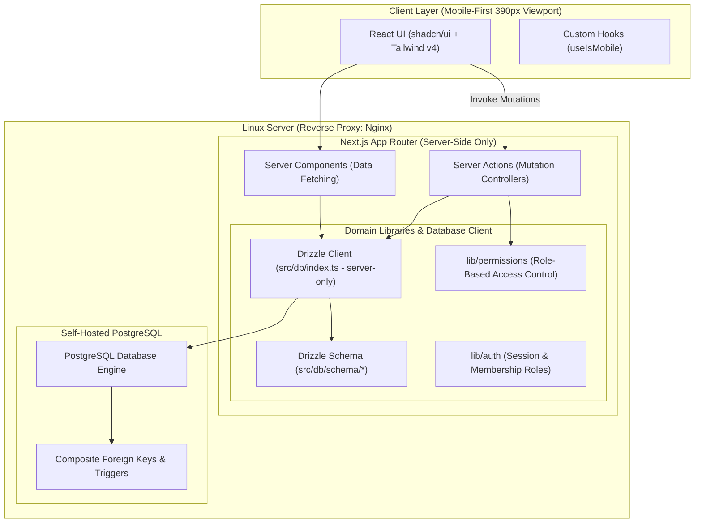

# System Architecture: Multi-Tenant Barber Appointment Platform

## 1. High-Level Architecture Overview

The application is built on Next.js App Router, fully self-hosted on Linux behind Nginx, backed by standard PostgreSQL and Drizzle ORM.



---

## 2. Directory Architecture & Separation of Concerns

The codebase is organized into strict modular boundaries:

```
src/
├── actions/                  # Next.js Server Actions (Mutation controllers)
├── app/                      # Next.js App Router route groups & layouts
│   ├── (auth)/               # Authentication route group (Login)
│   │   ├── layout.tsx
│   │   └── login/page.tsx
│   ├── (dashboard)/          # Authenticated portal (Owner, Admin & Staff)
│   │   ├── layout.tsx
│   │   └── dashboard/page.tsx
│   ├── (public)/             # Public customer-facing booking funnel
│   │   ├── layout.tsx
│   │   └── page.tsx          # Mobile-first landing & booking entry
│   ├── globals.css           # Tailwind v4 theme & base variables
│   └── layout.tsx            # Global HTML document shell
├── components/               # UI Presentation components
│   ├── common/               # Shared presentational widgets (StatusBadge)
│   ├── layout/               # Shell components (Header, MobileNav)
│   └── ui/                   # Reusable shadcn/ui primitives (Button, Card, Input)
├── db/                       # Database layer (Server-only)
│   ├── index.ts              # Server-only Drizzle client setup (`drizzle-orm/node-postgres`)
│   └── schema/               # Drizzle table schemas, composite FKs & enums
│       ├── users.ts          # Core system user records
│       ├── businesses.ts     # Business tenant boundaries
│       ├── members.ts        # Business members and roles (`OWNER`, `ADMIN`, `STAFF`)
│       ├── services.ts       # Dynamic service catalogs
│       ├── staff.ts          # Staff profiles & staff-service mappings
│       ├── customers.ts      # Business-scoped customer records
│       ├── scheduling.ts     # Business/staff working hours & time blocks
│       ├── appointments.ts   # Appointments & service snapshots
│       └── index.ts          # Schema barrel export
├── hooks/                    # Client-side custom React hooks
│   └── use-mobile.ts         # Viewport subscription (useSyncExternalStore)
├── lib/                      # Core business logic
│   ├── auth/                 # Session & role helpers
│   ├── permissions/          # Role-Based Access Control (RBAC) matrices
│   └── utils.ts              # CSS utility (twMerge + clsx)
├── middleware.ts             # Next.js root request interceptor
└── types/                    # Domain models & TypeScript interfaces
    ├── business.ts           # Business & working hours types
    ├── staff.ts              # Staff profile, services, and time block types
    ├── service.ts            # Dynamic service model types
    ├── customer.ts           # Business-scoped customer types
    ├── appointment.ts        # Appointment & snapshot types
    ├── user.ts               # Auth user & membership types
    └── index.ts              # Types barrel export
drizzle/
└── migrations/               # Drizzle Kit SQL migrations & database triggers
```

---

## 3. Core Architectural Principles

### 3.1 Server-Only Database Isolation
- `src/db/index.ts` is guarded with `import "server-only"`.
- `DATABASE_URL` is a private server-side environment variable and must NEVER be exposed to client bundles or browsers (`NEXT_PUBLIC_` is strictly prohibited).
- Database operations occur strictly inside Server Components, Server Actions, or server-side utility functions.

### 3.2 Relational Integrity & Composite Foreign Keys
- Multi-tenancy is enforced in the database schema using composite foreign keys `(business_id, entity_id)` across all tenant child tables.
- Cross-tenant data leaks are prevented at the database level by PostgreSQL foreign key constraints.

### 3.3 Dynamic Service & Calendar Architecture
- Service names, prices, durations, and booking intervals are completely dynamic.
- Staff members have independent calendar working hours and time block overrides (`BREAK`, `VACATION`, `BUSINESS_CLOSURE`, `OTHER`).

### 3.4 Onboarding Progression & Server-Derived State
- Onboarding progression is not stored in fragile client cookies or mutable step columns; it is derived server-side from real domain state:
  1. `UNAUTHENTICATED`: No active session -> `/login`.
  2. `NO_BUSINESS`: Session exists with 0 business memberships -> `/onboarding`.
  3. `BUSINESS_HOURS`: Business exists with incomplete weekly schedule (fewer than 7 rows in `business_working_hours`) -> `/onboarding/business-hours`.
  4. `FIRST_SERVICE`: 7-day schedule configured, but 0 services created in `services` -> `/onboarding/first-service`.
  5. `OWNER_STAFF`: 7-day schedule configured, >= 1 service created, onboarding not completed -> `/onboarding/owner-staff`.
  6. `COMPLETED`: `businesses.onboarding_completed_at IS NOT NULL` -> `/dashboard`.
- Working hours are saved atomically (all 7 days together) using a database transaction with rollback guarantees.
- The final onboarding step (/onboarding/owner-staff) atomically executes the owner staff profile decision (YES with staff_profile and staff_services, or NO) and sets `businesses.onboarding_completed_at = now()`.

### 3.5 Service Management Architecture (Post-Onboarding)
- **Route Hierarchy**:
  - `/dashboard/services`: Paginated/card listing of services with active/inactive indicators, toggle switches, and quick actions.
  - `/dashboard/services/new`: Dynamic service creation form.
  - `/dashboard/services/[serviceId]/edit`: Scoped service update form.
- **Server-Side RBAC**:
  - Service management operations are restricted to `OWNER` and `ADMIN` roles using `requireAdminOrOwner(businessId)`.
  - `STAFF` members are forbidden from viewing or manipulating service catalogs (redirected from UI, rejected by Server Actions).
- **Tenant Isolation**:
  - Operations are strictly scoped to the active tenant's `business_id` determined server-side from session membership.
  - Repository methods enforce `and(eq(services.businessId, businessId), eq(services.id, serviceId))` on all lookups and mutations.
- **Soft Deletion & Snapshot Preservation**:
  - Services are never physically deleted (`active` flag toggling only).
  - Foreign key constraint `appointments_service_fkey` (`ON DELETE RESTRICT`) prevents orphan appointment records.
  - Modifying service parameters affects future bookings only; historical appointment records maintain immutable snapshots.

### 3.6 Staff Management & Invitation Architecture (Post-Onboarding)
- **Route Hierarchy**:
  - `/dashboard/staff`: Staff roster view displaying members, roles, bookable calendar status, active toggles.
- **Server-Side RBAC**:
  - Operations are authorized strictly for `OWNER` and `ADMIN` roles using `requireAdminOrOwner(businessId)`.
  - `STAFF` members are forbidden from managing staff rosters.
  - Role safety: `OWNER` and `ADMIN` cannot be deactivated through staff management actions.
- **Self-Hosted Cryptographic Invitation Engine**:
  - Eliminates reliance on external email SaaS or third-party auth services.
  - Generates 256-bit cryptographically random tokens (`crypto.randomBytes(32)`).
  - Deactivating a staff member toggles `business_members.active = false` and cascades to `staff_profiles.active = false` and `staff_profiles.public_booking_enabled = false`.
  - Reactivation restores active flags without duplicate row creation.
  - No physical deletion: User identity, business membership, staff profile, and historical appointment records remain permanently preserved.

### 3.8 Staff Service Assignment & Booking Readiness Architecture (TASK 005C.1)
- **Route Hierarchy**:
  - `/dashboard/staff/[staffId]`: Staff profile detail, service assignments, and public booking readiness controls.
- **Hierarchical RBAC Boundaries**:
  - `OWNER` users have full authority over all staff profiles within their business, including their own owner staff profile.
  - `ADMIN` users can manage `STAFF` profiles only. Any attempt by an `ADMIN` to view, modify services, or toggle booking for the `OWNER`'s staff profile is strictly rejected with `ForbiddenError`.
  - `STAFF` users are strictly forbidden from staff profile management.
- **Derived Booking Readiness Engine (`evaluateBookingReadiness`)**:
  - Pure server-side derived calculation; no `booking_ready` column is persisted.
  - Evaluates 5 preconditions:
    1. Member active (`business_members.active = true`)
    2. Profile active (`staff_profiles.active = true`)
    3. Public booking toggle enabled (`staff_profiles.public_booking_enabled = true`)
    4. Active assigned services count >= 1
    5. Schedule source complete (`uses_business_hours = true` AND exactly 7 `business_working_hours` records exist)
  - Returns `isReady: boolean`, `reasons: string[]`, and structured breakdown details.
- **Service Assignment Synchronization (`syncStaffServices`)**:
  - Atomic database transaction synchronizes `staff_services` records.
  - Requires newly added services to be active and belong to the tenant.
  - Preserves legacy inactive service mappings unless explicitly removed by user (`removeInactiveServiceIds`).
  - Auto-disables `public_booking_enabled = false` in the same transaction if active assigned services count reaches 0.
- **Service Catalog Deactivation Cascading**:
  - `setServiceActive(businessId, serviceId, false)` retains existing `staff_services` mappings for historical and administrative integrity.
  - Calls `autoDisablePublicBookingForStaffWithNoActiveServices(businessId)` to instantly disable public booking for any staff member left without active services.
- **Mobile-First Responsive Interface**:
  - Target width: 390px responsive container, touch targets >= 44-48px.
  - Clear visual feedback for booking readiness with state badge, active/inactive indicators, and actionable status messages.

### 3.9 Staff Working Hours Architecture (TASK 005C.2)
- **Schedule Mode Architecture**:
  - `staff_profiles.uses_business_hours`: Boolean flag determining whether the staff member inherits `business_working_hours` (`true`) or uses custom `staff_working_hours` (`false`).
  - Switching mode preserves stored custom schedule rows in `staff_working_hours` without deletion, allowing seamless switching back.
- **Canonical Boolean & Strict Check Constraint Invariant**:
  - Single canonical state column: `is_working` boolean.
  - Working day: `is_working = true`, `start_time` NOT NULL, `end_time` NOT NULL, `start_time < end_time`.
  - Closed day: `is_working = false`, `start_time` NULL, `end_time` NULL.
  - Database-enforced via PostgreSQL check constraint `check_swh_hours`:
    `((is_working = false AND start_time IS NULL AND end_time IS NULL) OR (is_working = true AND start_time IS NOT NULL AND end_time IS NOT NULL AND start_time < end_time))`.
- **Atomic Schedule Operations (`replaceStaffWorkingHours`)**:
  - Deletes and re-inserts all 7 days (0..6) within a single PostgreSQL transaction.
  - Automatically updates `staff_profiles.uses_business_hours = false`.
  - Atomically sets `public_booking_enabled = false` if the custom schedule has 0 working days (all 7 days closed).
- **Schedule Mode Switching (`updateStaffScheduleMode`)**:
  - Switches `uses_business_hours` without modifying `staff_working_hours` rows.
  - Atomically sets `public_booking_enabled = false` if switching to an effective schedule that is not booking-ready (e.g. < 7 days or 0 open days).
- **Extended Booking Readiness Engine**:
  - Evaluates effective schedule based on current mode:
    - `usesBusinessHours = true`: validates `business_working_hours` (7 rows, >= 1 open day).
    - `usesBusinessHours = false`: validates `staff_working_hours` (7 rows, >= 1 working day).
  - Enforces prerequisite check: `toggleStaffPublicBooking` cannot enable public booking if effective schedule is invalid or has 0 open days.
- **Server-Side Tenant Resolution & RBAC**:
  - Server actions `saveStaffWorkingHoursAction` and `setStaffScheduleModeAction` derive `businessId` and caller role authoritatively from session. Client payloads do not provide `businessId`.
  - OWNER can manage all profiles; ADMIN can manage STAFF profiles only; ADMIN blocked from OWNER with `ForbiddenError`.
- **Mobile-First Client Experience**:
  - Located on `/dashboard/staff/[staffId]` between public booking toggle and service assignment cards.
  - Segmented mode switcher ("İşletme Çalışma Saatleri" vs "Özel Çalışma Saatleri").
  - Inherited mode displays read-only weekly summary of business hours.
  - Custom mode displays 7-day editor (Monday to Sunday) with Açık/Kapalı switches and start/end time inputs. Touch targets >= 44px min-height.
  - First-time prefill from business hours is UX-only and never saved until user explicitly clicks Save.

### 3.10 Staff Time Off / Break / Block Management Architecture (TASK 006A)
- **Domain Purpose & Scope**:
  - Manages staff unavailability intervals (`time_blocks`) for the future availability calculation engine.
  - Decoupled from appointments, payments, and customers.
  - Decoupled from weekly working hours (`staff_working_hours` / `business_working_hours`) and booking readiness state.
- **Strict PostgreSQL Enum Model (`time_block_type`)**:
  - Valid values: `TIME_OFF`, `BREAK`, `BLOCKED`.
  - Migration `0007_time_block_types.sql` migrated enum from old placeholder values to the canonical 3 types, enforcing data integrity at the database layer.
- **Concurrency-Safe Overlap Prevention**:
  - Serialization: All insert and update operations acquire an exclusive row-level lock on the staff profile (`SELECT id FROM staff_profiles WHERE id = targetStaffId AND business_id = businessId FOR UPDATE`) inside the database transaction.
  - Overlap check executes within the lock: `new.startTime < existing.endTime AND new.endTime > existing.startTime`.
  - Allows exact abutting / back-to-back blocks (`existing.endTime == new.startTime`).
  - Guarantees zero race condition susceptibility when multiple parallel requests attempt to book conflicting blocks.
- **Timezone Resolution & DST Transition Engine**:
  - Resolves business timezone from `businesses.timezone` (default `Europe/Istanbul`).
  - Parses wall-clock inputs (`YYYY-MM-DD`, `HH:mm`) into UTC `timestamptz` using `date-fns-tz`.
  - Detects and rejects nonexistent local times during DST spring-forward transitions.
  - Formats persisted UTC timestamps back into local wall-clock dates and times for client presentation.
- **Immutability of Historical Records & Lifecycle Evaluation**:
  - Server-side status calculation:
    - `ACTIVE`: `startTime <= now() AND endTime > now()`
    - `UPCOMING`: `startTime > now()`
    - `PAST`: `endTime <= now()`
  - Past blocks are immutable: update and delete operations reject modifications if `block.endTime <= now()`.
- **RBAC & Multi-Tenant Enforcement**:
  - Server actions `getStaffTimeBlocksAction`, `createStaffTimeBlockAction`, `updateStaffTimeBlockAction`, `deleteStaffTimeBlockAction` resolve `businessId` and caller role directly from the session.
  - OWNER can manage all profiles; ADMIN can manage STAFF profiles only (ADMIN is blocked from OWNER with 403 Forbidden).
  - STAFF members cannot manage time blocks.
- **UI Architecture (`/dashboard/staff/[staffId]`)**:
  - Dedicated "Müsait Olmadığı Zamanlar" card located below weekly schedule editor.
  - Shows localized date, time range, badge for block type (`İzin`, `Mola`, `Blok / Kapatma`), and status badge (`Aktif`, `Gelecek`, `Geçmiş`).
  - Provides inline collapsible create/edit form with responsive inputs (min-h-[44px]), client-side validation, and server error handling.
  - Past blocks display "Geçmiş kayıtlar düzenlenemez veya silinemez" indicator without action buttons.

### 3.11 Platform Administration Foundation (TASK 010A)
- **Platform Authority vs Business/Tenant Authority**:
  - **Core Architectural Invariant**: *Business OWNER/ADMIN roles never imply platform administration privileges.*
  - Tenant roles (`OWNER`, `ADMIN`, `STAFF`) are scoped strictly to `business_members` for intra-business operations.
  - Platform administrators are decoupled from tenant memberships and modeled in the dedicated `platform_admins` table linked directly to Better Auth `users.id`.
  - Platform authority operates ABOVE tenant scope; platform context does not implicitly inject a tenant `businessId`.
- **Platform Authorization Model**:
  - `platform_admins`: `id` (UUID PK), `user_id` (FK to `users.id`, UNIQUE constraint), `role` (`platform_admin_role` enum: `SUPER_ADMIN`, `ADMIN`), `active` (boolean, default true), `created_at`, `updated_at`.
  - `SUPER_ADMIN`: Highest platform authority with future capability to manage platform operators.
  - `ADMIN`: Platform operator with read-only metrics access in TASK 010A and future business management capabilities.
- **Server-Side Bootstrapping CLI**:
  - Zero public HTTP exposure for admin granting.
  - CLI script `pnpm platform-admin:grant --email <email> --role <SUPER_ADMIN|ADMIN>` performs server-side validation and idempotent upsert.
  - CLI script `pnpm platform-admin:list` safely reports platform administrator status without sensitive data.
- **Centralized Platform Guards**:
  - `requirePlatformAdmin()`: Enforces authenticated session + active `platform_admins` row in DB, returning typed context `{ userId, platformAdminId, platformRole }`.
  - `requirePlatformSuperAdmin()`: Enforces `SUPER_ADMIN` role specifically.
  - Client-side headers, request bodies, or business memberships cannot spoof platform access.
- **Platform Audit Log Foundation**:
  - `platform_admin_audit_logs`: `id`, `platform_admin_id`, `actor_user_id`, `action`, `target_type`, `target_id`, `metadata` (jsonb), `created_at`.
  - Automatically records bootstrap events and future administrative mutations without storing secrets or raw credentials.
- **Global Data Access Boundaries**:
  - `PlatformAdminRepository` & `PlatformAdminService`: Provide platform-wide aggregate reads (`totalBusinesses`, `activeBusinesses`, `totalUsers`, `totalStaff`, `totalAppointments`) without tenant filtering.
  - Global repositories are strictly unexposed to business dashboard actions.
- **Route Namespace & Navigation Isolation**:
  - Route namespace: `/platform` (separate from `/dashboard`).
  - Navigation isolation: Ordinary business users never see links to `/platform`. Active platform admins are conditionally provided a discreet "Platform" link in the header.
  - Turkish-only UI compliance: All page headings, labels, badges, empty states, and access-denied screens are rendered in natural Turkish.

### 3.12 Platform Business Management (TASK 010B)
- **Business Lifecycle Control**:
  - Leverages the existing `businesses.active` boolean to instantly toggle business availability.
  - **Public Isolation**: `PublicBookingRepository` enforces `biz.active === true`. Deactivating a business immediately returns a 404/Unavailable state for public booking flows.
  - **Dashboard Continuation**: Business dashboard layout guards check the user's `business_members.active` row but do *not* check `businesses.active`. This allows disabled businesses to log in, view historical records, and access support without accepting new public appointments.
- **Transactional State Mutation**:
  - Business state toggles (`PlatformAdminRepository.toggleBusinessActive`) are executed inside a single transaction.
  - Implements row-level locking via `SELECT ... FOR UPDATE` to prevent concurrent modification interleaving.
  - Atomically writes an event to `platform_admin_audit_logs` detailing the action (`BUSINESS_ACTIVATED` / `BUSINESS_DEACTIVATED`), the administrator, the target `business_id`, and the mandatory change reason.
- **Platform Business Views**:
  - `/platform/businesses`: Lists all tenants with pagination, search (by name/slug), and status filtering.
  - `/platform/businesses/[businessId]`: Detail view providing aggregate operational metrics (total staff, total appointments) and identifying information (owners) without exposing consumer PII. Includes a paginated rendering of the specific business's platform audit history.

### 3.13 Customer CRM, Manual Appointment Integration & Duplicate Architecture (TASK 013C.1)
- **Manual Booking Customer Selector Integration**:
  - Step 4 of the manual booking wizard (`/dashboard/appointments/new`) implements dual-mode customer provisioning: "Mevcut Müşteri" (searchable dropdown) and "Yeni Müşteri" (name/phone inputs).
  - Search queries execute via `searchCustomersForBookingAction`, matching first name, last name, or normalized phone prefix within the caller's tenant (`business_id`).
  - Selecting an existing customer preserves the CRM profile completely: the appointment transaction verifies tenant ownership and directly sets `appointments.customer_id = existingCustomerId` without invoking `upsertCustomer`.
  - Appointment notes are stored in `appointments.notes` and do not touch customer internal notes.
- **Role-Based Privacy Boundary**:
  - `OWNER` and `ADMIN` have full CRM access (customer directory at `/dashboard/customers`, profile editing, and internal notes).
  - `STAFF` members are forbidden from CRM directory, customer editing, and notes.
  - For operational efficiency, `STAFF` is granted purpose-limited access to `searchCustomersForBookingAction` strictly when creating appointments for their own calendar, returning minimal operational fields without exposing CRM notes or private audit trails.
- **Duplicate Candidate Detection**:
  - `CustomerRepository.getDuplicateCandidates` analyzes tenant customer phone numbers using `customerPhoneComparisonKey`, which normalizes various Turkish phone formats (`05xx`, `+905xx`, `905xx`, `5xx`) into canonical E.164 strings.
  - Clusters records with identical comparison keys into candidate groups with calculated confidence levels (`HIGH` or `POSSIBLE`) and explanatory Turkish descriptions.
  - Review at `/dashboard/customers/duplicates` is restricted to `OWNER` and `ADMIN`.
  - Detection itself is non-destructive and never auto-merges or deletes. TASK 013C.2C adds a separate explicit selection and confirmation mutation.
- **Merge Architecture Foundations**:
  - The PostgreSQL immutability trigger `prevent_appointment_column_change()` strictly prevents updating `customer_id` on existing appointment rows.
  - Physical customer merge is forbidden; logical alias lineage is the required architecture.

### 3.14 Logical Customer Merge Foundation (TASK 013C.2A)
- **Retained Alias Lineage**:
  - Canonical customers have `merged_into_customer_id IS NULL`; aliases retain their original rows and point directly to the selected canonical root.
  - Existing `appointments.customer_id` and `customer_notes.customer_id` values are never modified.
- **Tenant and Provenance Integrity**:
  - Composite foreign keys bind merge targets and merge authors to the same `business_id`, both using `ON DELETE RESTRICT`.
  - Database checks reject self-merge and partial merge metadata; a deferred constraint trigger enforces one-hop lineage.
- **Persisted Phone Comparison**:
  - `phone_comparison_key` stores application-equivalent `customerPhoneComparisonKey` output without replacing `normalized_phone` and without uniqueness.
  - Public/manual creation, profile edits, QA bootstrap, migration backfill, and a database synchronization trigger keep it current.
- **Transactional Merge Service**:
  - `CustomerMergeService` derives tenant authority from the canonical customer and authenticated active membership, permits only `OWNER`/`ADMIN`, reloads the complete equal-key group, and locks lineage rows in deterministic UUID order.
  - Existing valid aliases are flattened to the selected root; stale, corrupt, cyclic, cross-tenant, or ineligible requests return typed safe errors.
- **Product integration**:
  - TASK 013C.2C exposes this service only through an explicit canonical selection and confirmation workflow.

### 3.15 Canonical Customer Resolution & CRM Family Aggregation (TASK 013C.2B)
- **Central resolution boundary**:
  - `resolveCanonicalCustomer` is the only server primitive for resolving a tenant-scoped customer ID. Canonical IDs resolve to themselves; alias IDs resolve to their direct root; missing, cross-tenant, chained, or cyclic state fails safely.
  - `getCustomerFamily` returns only the canonical root plus direct aliases for that tenant and uses the `(business_id, merged_into_customer_id)` index.
- **Future booking identity**:
  - Resolution first preserves authoritative `(business_id, normalized_phone)` matching and canonicalizes an exact alias match.
  - Only when no exact match exists, persisted `phone_comparison_key` is considered. A single proven canonical family (including a lone canonical row) may resolve automatically; multiple independent roots produce a typed ambiguity and no customer/appointment mutation.
  - Public specific-staff, public `Fark Etmez`, manual new-customer, and stale manual customer-ID paths write the canonical customer ID. Existing appointments are never rewritten, and booking never overwrites an existing customer profile.
- **Family-aware CRM**:
  - Directory pagination is rooted at `merged_into_customer_id IS NULL`; metrics aggregate appointments across each root and its aliases in set-based SQL.
  - Directory and purpose-limited booking search match canonical or alias names/phones but return the canonical DTO once. STAFF receives only the existing minimal booking fields, never notes or lineage.
  - Customer detail/history and notes aggregate the family while preserving canonical profile fields, immutable service snapshots, original appointment `customer_id`, and original note `customer_id`.
  - New notes resolve stale alias IDs and attach to the canonical row. Existing alias-origin notes can be edited/deleted only after tenant-scoped family membership is proven.
- **Routes, edits, and duplicate review**:
  - Authorized alias detail routes redirect to the canonical route; cross-tenant IDs remain not-found and STAFF remains outside CRM detail.
  - Alias profile mutation remains forbidden. A canonical phone change that overlaps another independent comparison-key family is rejected without auto-merge.
  - Candidate detection displays independent canonical roots only; a fully merged family disappears from review. Merge execution remains a separate explicit action.

### 3.16 Operational Customer Merge Workflow (TASK 013C.2C)
- **Explicit operator decision**:
  - `/dashboard/customers/duplicates` is restricted to tenant `OWNER`/`ADMIN` and presents a deliberate review workflow. The operator must enter review mode, explicitly select a radio-card `Birincil Müşteri`, review consequences, and confirm in an accessible alert dialog.
  - No customer is preselected, no candidate is auto-merged, and activity/age never overrides the operator's explicit canonical choice.
- **Server action boundary**:
  - `mergeCustomersAction(canonicalCustomerId, selectedCustomerIds)` treats both ID inputs as untrusted references. It derives the actor from the authenticated session and delegates tenant authority, complete-group reload, eligibility, serializable locking, and lineage validation to `CustomerMergeService`.
  - The browser-facing success DTO contains only the canonical customer ID. Typed stale, conflict, ineligible, not-found, and forbidden outcomes map to safe Turkish messages; SQLSTATE, constraint names, stack traces, and repository internals stay server-side.
- **Stale/concurrent behavior**:
  - The candidate screen is only a snapshot. A concurrent merge or eligibility change is never retried automatically. The action returns a typed safe result, the client refreshes current truth, and no partial family is committed.
  - Duplicate review, directory, and canonical detail routes are revalidated after success; navigation lands on the canonical profile with restrained success feedback.
- **Lineage read model**:
  - Canonical detail performs one tenant-scoped alias query and renders `Birleştirilen Kayıtlar` only when aliases exist. It exposes previous name, previous phone, merge timestamp, and (when present) the business member's display name, but never raw IDs or comparison keys.
  - Lineage is management CRM data: OWNER/ADMIN only. STAFF purpose-limited booking search and all public flows remain lineage-free.
- **Historical immutability and V1 scope**:
  - Merge changes only customer merge metadata. Customer rows remain, appointment customer IDs and service snapshots remain unchanged, and historical note customer IDs remain unchanged.
  - There is no unmerge, physical deletion, appointment reassignment, or note reassignment operation in V1.

### 3.17 Secure Public Appointment Management Access (TASK 014A)
- **Accountless capability model**:
  - A successful public booking issues a cryptographically random 32-byte (256-bit) base64url token. Only `SHA-256(rawToken)` is stored in `appointment_access_tokens`; the raw token is returned once in the booking success DTO as the URL fragment `/randevu#<token>` and is never logged or persisted server-side.
  - URL-fragment delivery is intentional: fragments are not sent in HTTP request targets and therefore stay out of normal Next.js/Nginx access logs and referrers. The client captures the fragment, immediately removes it from browser history/address state, and submits it to a server action for hashing and resolution. Next.js development request logging excludes `/randevu`, and Server Function argument logging is disabled.
  - `token_hash` is globally unique. Multiple active token rows may reference one appointment so a future notification system can issue a fresh link without implicitly revoking previous links.
- **Transactional finalization**:
  - Specific-staff and `Fark Etmez` public bookings issue the token inside the same staff-locked appointment transaction. Token persistence failure rolls back the appointment and any newly created customer; public success therefore always includes management access.
  - Historical and manual appointments are not backfilled. The server-only issuance primitive can create a recoverable raw link for an existing operational appointment later.
- **Validity and revocation**:
  - The centralized validity policy expires access at appointment end time plus 24 hours. Internal rescheduling refreshes existing token expirations atomically to the new end time plus the same grace period.
  - `revoked_at` invalidates a token immediately. Issuing another token does not auto-revoke existing tokens.
- **Read-only public boundary**:
  - `/randevu` submits the captured fragment secret to a server-only resolver, which hashes it, validates syntax, expiry, and revocation, then returns only business name, appointment service snapshots, current assigned staff display name, business-timezone date/time, price/currency, duration, and Turkish status.
  - The route exposes no database IDs, customer/appointment notes, CRM history, merge lineage, membership data, contact PII, cancellation, or rescheduling mutation.
  - Missing, malformed, unknown, expired, and revoked tokens share one non-oracular Turkish invalid-link state.
- **Capability URL protections**:
  - Responses use `Cache-Control: private, no-store`, `Referrer-Policy: no-referrer`, and `X-Robots-Tag: noindex, nofollow, noarchive`; route metadata also disables indexing.
  - The route is request-time rendered and contains no analytics or unrelated third-party resources.

### 3.18 Secure Public Appointment Cancellation (TASK 014B)
- **Central lifecycle policy**:
  - `canPubliclyCancelAppointment` is the only public-cancellation eligibility rule. It permits `PENDING` or `CONFIRMED` only while authoritative server time is strictly before `appointments.start_time`.
  - `CANCELLED` is idempotent for equivalent repeated capability submissions. `COMPLETED`, `NO_SHOW`, and started appointments remain ineligible. No configurable notice window or cancellation reason exists in V1.
- **Capability-authorized mutation**:
  - The browser submits only the retained raw fragment capability. It never supplies appointment, customer, or business IDs as authority. The server validates syntax, hashes the token, derives its tenant/appointment, and returns only sanitized management DTOs/outcomes.
  - Mutation preserves the existing lock hierarchy: initial capability lookup, `staff_profiles` row lock, appointment row lock/re-read, then capability row lock/revalidation. Status/time are checked again using mutation-time server truth before setting only `status = CANCELLED` (with the existing `updated_at` trigger).
  - The ordering serializes safely with public booking, internal status changes, reassignment, and rescheduling. A cancellation that commits first prevents rescheduling from resurrecting the appointment; a reschedule that commits first is re-read before cancellation.
- **Read model and token lifecycle**:
  - The management DTO adds only `canCancel`. It is presentation guidance; the mutation always revalidates capability, status, and time.
  - Successful cancellation retains every valid management token until normal expiry or explicit revocation. All active tokens observe `CANCELLED` and `canCancel = false`.
  - `CANCELLED` remains non-blocking in the shared availability repositories, so the released time becomes available through the normal scheduling engine without deletion or special slot state.
- **Public UX boundary**:
  - Cancellation requires an accessible alert-dialog confirmation, pending/disabled state, and an explicit destructive action. Success remains on `/randevu`, announces `Randevunuz iptal edildi.`, refreshes the summary, and removes the control.
  - Invalid capabilities preserve the existing non-oracular state. Stale eligibility uses the generic operational message `Bu randevu artık iptal edilemiyor.` Public rescheduling is not implemented.
