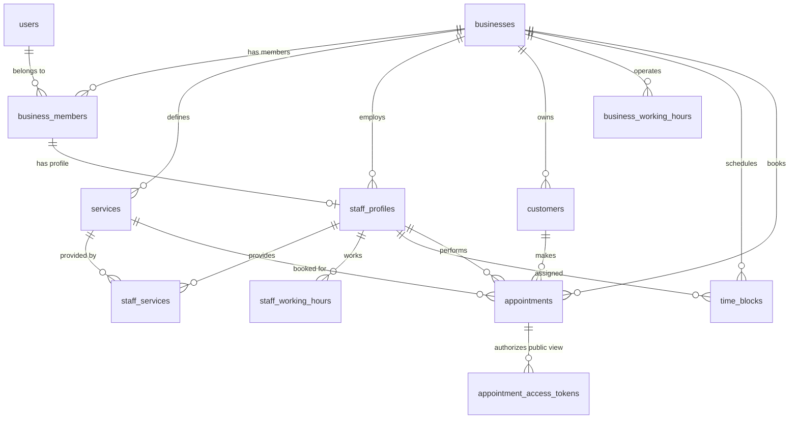

# Database Specification: PostgreSQL & Drizzle ORM Schema

## 1. Overview
The database layer is built on self-hosted PostgreSQL managed via **Drizzle ORM** (`drizzle-orm` and `drizzle-kit`).
All table definitions live in `src/db/schema/` and SQL migrations with triggers live in `drizzle/migrations/`.

---

## 2. Entity-Relationship Schema

---

## 3. Core Tables Reference

### 3.1 `users`
System user accounts.
- `id` (uuid, PK, default `gen_random_uuid()`)
- `email` (text, unique, NOT NULL)
- `created_at` (timestamptz, default `now()`)
- `updated_at` (timestamptz, default `now()`)

### 3.2 `businesses` (Tenant Boundary)
- `id` (uuid, PK, default `gen_random_uuid()`)
- `name` (text, NOT NULL)
- `slug` (text, unique, NOT NULL)
- `phone`, `address`, `logo_url` (text, nullable)
- `timezone` (text, NOT NULL, checked via `is_valid_timezone()`)
- `currency` (text, NOT NULL, ISO code e.g. `TRY`, `USD`, `EUR`)
- `booking_interval_minutes` (integer, default 15, checked `IN (5, 10, 15, 20, 30, 60)`)
- `active` (boolean, default true, NOT NULL)
- `created_at`, `updated_at` (timestamptz, NOT NULL)

### 3.3 `business_members`
Connects users to businesses with role assignments.
- `id` (uuid, PK, default `gen_random_uuid()`)
- `business_id` (uuid, FK `businesses.id` ON DELETE CASCADE, NOT NULL)
- `user_id` (uuid, FK `users.id` ON DELETE CASCADE, NOT NULL)
- `role` (`business_member_role` enum: `'OWNER'`, `'ADMIN'`, `'STAFF'`, NOT NULL)
- `active` (boolean, default true, NOT NULL)
- `created_at`, `updated_at` (timestamptz, NOT NULL)
- Constraints:
  - UNIQUE `(business_id, user_id)`
  - UNIQUE `(business_id, id)`
  - Partial Unique Index `business_members_one_owner_idx`: `UNIQUE (business_id) WHERE role = 'OWNER'`

### 3.4 `services`
Dynamic service catalog per business.
- `id` (uuid, PK, default `gen_random_uuid()`)
- `business_id` (uuid, FK `businesses.id` ON DELETE CASCADE, NOT NULL)
- `name` (text, NOT NULL)
- `description` (text, nullable)
- `duration_minutes` (integer, NOT NULL, check > 0)
- `price` (numeric(10, 2), NOT NULL, check >= 0)
- `active` (boolean, default true, NOT NULL)
- `created_at`, `updated_at` (timestamptz, NOT NULL)
- Constraints:
  - UNIQUE `(business_id, id)`

### 3.5 `staff_profiles`
Barber profiles linked to business memberships.
- `id` (uuid, PK, default `gen_random_uuid()`)
- `business_id` (uuid, FK `businesses.id` ON DELETE CASCADE, NOT NULL)
- `business_member_id` (uuid, unique, FK `business_members.id`, NOT NULL)
- `first_name` (text, NOT NULL)
- `last_name` (text, NOT NULL)
- `phone`, `profile_image_url` (text, nullable)
- `public_booking_enabled` (boolean, default true, NOT NULL)
- `uses_business_hours` (boolean, default true, NOT NULL)
- `active` (boolean, default true, NOT NULL)
- `created_at`, `updated_at` (timestamptz, NOT NULL)
- Composite FK: `(business_id, business_member_id) -> business_members(business_id, id)`
- Constraints:
  - UNIQUE `(business_id, id)`

### 3.6 `staff_services`
Junction table mapping staff to services they perform.
- `business_id` (uuid, NOT NULL)
- `staff_id` (uuid, NOT NULL)
- `service_id` (uuid, NOT NULL)
- `created_at` (timestamptz, NOT NULL)
- Primary Key: `(staff_id, service_id)`
- Composite FKs:
  - `(business_id, staff_id) -> staff_profiles(business_id, id)` ON DELETE CASCADE
  - `(business_id, service_id) -> services(business_id, id)` ON DELETE CASCADE

### 3.7 `customers`
Business-scoped customer registry.
- `id` (uuid, PK, default `gen_random_uuid()`)
- `business_id` (uuid, FK `businesses.id` ON DELETE CASCADE, NOT NULL)
- `first_name` (text, NOT NULL)
- `last_name` (text, nullable)
- `phone` (text, NOT NULL)
- `normalized_phone` (text, NOT NULL, E.164 format)
- `phone_comparison_key` (text, NOT NULL, server-maintained; non-unique)
- `merged_into_customer_id` (uuid, nullable; NULL for canonical records)
- `merged_at` (timestamptz, nullable)
- `merged_by_business_member_id` (uuid, nullable)
- `notes` (text, nullable)
- `created_at`, `updated_at` (timestamptz, NOT NULL)
- Constraints:
  - UNIQUE `(business_id, normalized_phone)`
  - UNIQUE `(business_id, id)`
  - Composite FK `(business_id, merged_into_customer_id) -> customers(business_id, id)` ON DELETE RESTRICT
  - Composite FK `(business_id, merged_by_business_member_id) -> business_members(business_id, id)` ON DELETE RESTRICT
  - Check `customers_no_self_merge_check`: a customer cannot merge into itself
  - Check `customers_merge_metadata_check`: target, timestamp, and author are either all NULL or all populated
- Indexes:
  - `customers_business_phone_comparison_idx` on `(business_id, phone_comparison_key)`
  - `customers_business_merged_into_idx` on `(business_id, merged_into_customer_id)`
- Logical merge policy: aliases point directly to a canonical root; customer rows, appointment references, and note ownership are never moved or deleted by merge.
- Canonical read policy: family membership is the canonical row plus rows whose `merged_into_customer_id` equals the canonical ID. Directory pagination starts from canonical rows, while appointment and note aggregates join through this one-hop family.
- Booking resolution policy: exact `(business_id, normalized_phone)` remains authoritative and is canonicalized through lineage. Comparison-key fallback is allowed only for one unambiguous root family; comparison keys remain non-unique and never cause automatic merge.
- Historical preservation: resolving a future booking never updates an existing customer profile, `appointments.customer_id`, or historical `customer_notes.customer_id`. New notes submitted through stale alias IDs are inserted against the canonical customer.
- Operational merge write policy: the OWNER/ADMIN confirmation flow delegates to the serializable merge service; only alias merge metadata changes. The selected canonical row remains a root, all other family members point directly to it, and no appointment, service snapshot, note ownership, or customer row is rewritten/deleted.
- Lineage read policy: canonical CRM detail loads direct aliases with one tenant-scoped query for previous name/phone, merge timestamp, and optional merge-author display name. These fields are management-only and are not exposed to STAFF booking search or public flows.
- V1 deliberately has no reverse-lineage mutation or unmerge operation.

### 3.8 `business_working_hours`
Weekly schedule for the business across 7 days.
- `id` (uuid, PK)
- `business_id` (uuid, FK `businesses.id` ON DELETE CASCADE)
- `day_of_week` (smallint, 0..6: 0=Sunday, 1=Monday, 2=Tuesday, 3=Wednesday, 4=Thursday, 5=Friday, 6=Saturday)
- `start_time` (time, nullable; NOT NULL when `is_closed = false`, NULL when `is_closed = true`)
- `end_time` (time, nullable; NOT NULL when `is_closed = false`, NULL when `is_closed = true`)
- `is_closed` (boolean, default false)
- Constraints:
  - UNIQUE `(business_id, day_of_week)`
  - Check `check_bwh_day_of_week`: `day_of_week BETWEEN 0 AND 6`
  - Check `check_bwh_hours`: `is_closed = true OR start_time < end_time`
- Save Policy: All 7 days are saved atomically within a database transaction; revisiting replaces the 7 weekday rows idempotently.

### 3.9 `staff_working_hours`
- `id` (uuid, PK)
- `business_id`, `staff_id` (uuid, NOT NULL)
- `day_of_week` (smallint, 0..6: 0=Sunday, 1=Monday, ..., 6=Saturday)
- `start_time`, `end_time` (time, nullable: NULL when `is_working = false`, NOT NULL when `is_working = true`)
- `is_working` (boolean, default true)
- Composite FK: `(business_id, staff_id) -> staff_profiles(business_id, id)` ON DELETE CASCADE
- Constraints:
  - UNIQUE `(business_id, staff_id, day_of_week)`
  - Check `check_swh_day_of_week`: `day_of_week BETWEEN 0 AND 6`
  - Check `check_swh_hours`: `((is_working = false AND start_time IS NULL AND end_time IS NULL) OR (is_working = true AND start_time IS NOT NULL AND end_time IS NOT NULL AND start_time < end_time))`
- Save Policy: Atomic replacement of all 7 days in a single transaction; updates `staff_profiles.uses_business_hours = false`. Auto-disables `public_booking_enabled` if all 7 days are closed. Switching schedule mode never deletes these rows.

### 3.10 `time_blocks`
- `id` (uuid, PK)
- `business_id` (uuid, NOT NULL)
- `staff_id` (uuid, nullable)
- `block_type` (`time_block_type` enum: `'TIME_OFF'`, `'BREAK'`, `'BLOCKED'`, default: `'BLOCKED'`)
- `start_time`, `end_time` (timestamptz, NOT NULL)
- `reason` (text, nullable, max 500 chars in app layer)
- Composite FK: `(business_id, staff_id) -> staff_profiles(business_id, id)` ON DELETE CASCADE
- Constraints:
  - Check `check_time_blocks_time`: `start_time < end_time`
- Indexes:
  - `time_blocks_business_staff_time_idx` ON `(business_id, staff_id, start_time)`
- Concurrency & Overlap:
  - Overlap condition: `new.start_time < existing.end_time AND new.end_time > existing.start_time`
  - All creations and edits acquire an exclusive row-level lock on `staff_profiles` (`SELECT id FROM staff_profiles ... FOR UPDATE`) inside the transaction to eliminate race conditions.
  - Immutability: Records with `end_time <= NOW()` are read-only (cannot be edited or deleted).

### 3.11 `appointments`
- `id` (uuid, PK)
- `business_id`, `customer_id`, `staff_id`, `service_id` (uuid, NOT NULL)
- `start_time`, `end_time` (timestamptz, NOT NULL)
- `status` (`appointment_status` enum: `'PENDING'`, `'CONFIRMED'`, `'CANCELLED'`, `'COMPLETED'`, `'NO_SHOW'`)
- `source` (`appointment_source` enum: `'PUBLIC_WEB'`, `'MANUAL_ADMIN'`, `'MANUAL_STAFF'`)
- `service_name_snapshot` (text, NOT NULL)
- `service_duration_snapshot` (integer, NOT NULL)
- `service_price_snapshot` (numeric(10,2), NOT NULL)
- `cancellation_reason`, `notes` (text, nullable)
- Composite FKs:
  - `(business_id, customer_id) -> customers(business_id, id)` ON DELETE RESTRICT
  - `(business_id, staff_id) -> staff_profiles(business_id, id)` ON DELETE RESTRICT
  - `(business_id, service_id) -> services(business_id, id)` ON DELETE RESTRICT
- Constraints:
  - UNIQUE `(business_id, id)` (tenant-safe child references)
- Indexes:
  - `appointments_business_time_idx` ON `(business_id, start_time, end_time)`
  - `appointments_business_staff_time_idx` ON `(business_id, staff_id, start_time)`
  - `appointments_business_customer_idx` ON `(business_id, customer_id)`
- Public cancellation policy: no schema extension is required. A capability-authorized cancellation changes only `status` to `CANCELLED`; the existing `set_appointments_updated_at` trigger records the update. `cancellation_reason` remains untouched in V1, and all identity, assignment, timing, snapshot, note, and CRM fields remain unchanged.
- Scheduling policy: availability/conflict queries already exclude `CANCELLED`, so cancellation releases capacity without deleting or moving the appointment.

### 3.12 `appointment_access_tokens`
Appointment-scoped bearer capabilities for accountless public management access.

- `id` (uuid, PK, default `gen_random_uuid()`)
- `business_id`, `appointment_id` (uuid, NOT NULL)
- `token_hash` (text, NOT NULL, UNIQUE; exactly 64 hexadecimal SHA-256 characters by application contract)
- `expires_at` (timestamptz, NOT NULL)
- `revoked_at` (timestamptz, nullable)
- `created_at` (timestamptz, NOT NULL, default `now()`)
- Composite FK: `(business_id, appointment_id) -> appointments(business_id, id)` ON DELETE CASCADE
- Checks:
  - `char_length(token_hash) = 64`
  - `expires_at > created_at`
- Indexes:
  - UNIQUE index supplied by `token_hash` for capability lookup
  - `appointment_access_tokens_business_appointment_idx` on `(business_id, appointment_id)` for issuance/revocation lifecycle operations
- Security policy: raw tokens are generated with 256-bit entropy, returned only to the trusted issuance caller as a `/randevu#<token>` fragment, never persisted server-side, and resolved only after server-side SHA-256 hashing. URL fragments are not part of HTTP request targets and are removed from browser history immediately after capture.
- Lifetime policy: expiry is appointment end plus 24 hours and is refreshed when internal rescheduling changes the end time. Revocation is explicit; multiple independently revocable tokens per appointment are allowed.
- Cancellation policy: successful public cancellation does not update or revoke token rows. All otherwise-valid tokens for the appointment resolve the shared `CANCELLED` state until their normal expiry.
- Migration policy: migration `0014_appointment_access_tokens.sql` creates no token rows and does not modify appointments or customers.

---

## 4. Database Triggers & Functions
1. `set_updated_at()`: Trigger function that automatically updates `updated_at = NOW()` on row updates for all entities.
2. `enforce_appointment_snapshot()`: Trigger function BEFORE INSERT OR UPDATE on `appointments` that copies `name`, `duration_minutes`, `price` from `services` if snapshots are null.
3. `prevent_appointment_column_change()`: Trigger function BEFORE UPDATE on `appointments` that rejects changing `business_id`, `customer_id`, `staff_id`, or `service_id`.
4. `is_valid_timezone(tz text)`: Helper function that tests whether a timezone string is valid in PostgreSQL.
5. `customer_phone_comparison_key(text)` and `sync_customer_phone_comparison_key()`: Preserve application-equivalent comparison-key semantics during backfill and direct server-side writes.
6. `enforce_customer_merge_one_hop()`: Deferred constraint trigger that rejects aliases targeting aliases and canonical rows that still have inbound aliases when they become aliases.
